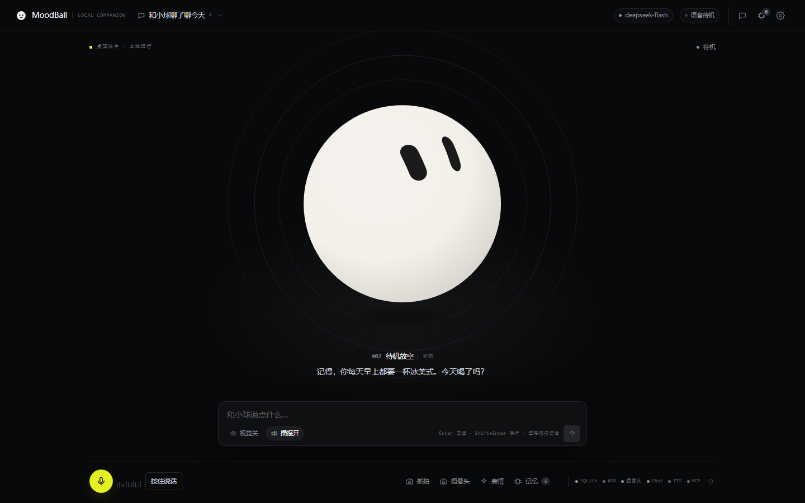
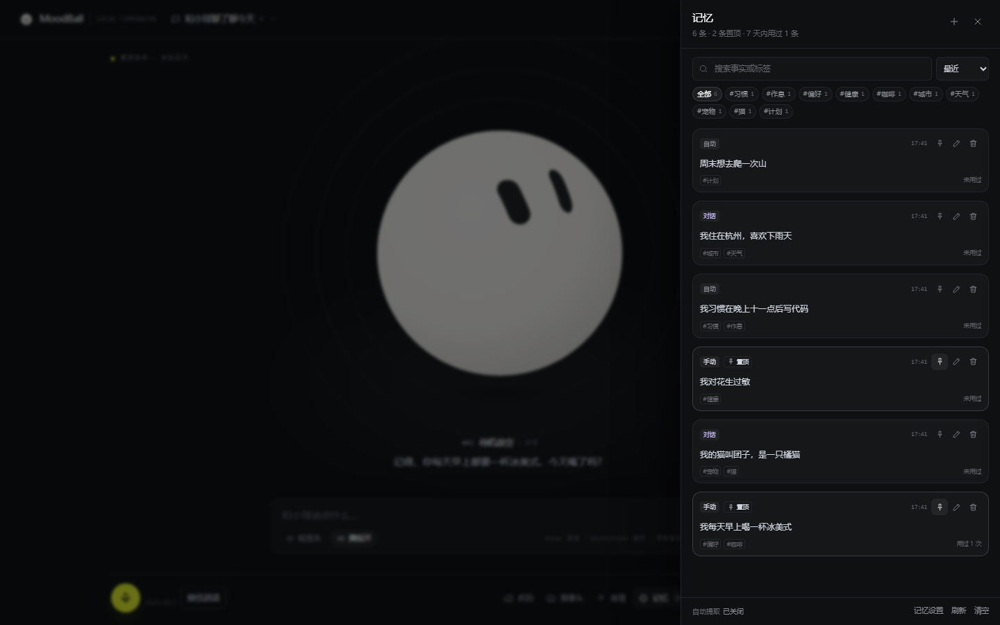

# MoodBall

一个跑在本机的桌面表情小球：**语音唤醒 → 对话 / 看摄像头 → 小球表情 → TTS 播报 → SQLite 持久化**。
按 [`docs/MoodBall-开发文档.md`](docs/MoodBall-开发文档.md) 实现，个人本机信任模型：只绑 `127.0.0.1`，不登录、不审批、Key 不入 git。



小球是界面的核心：表情、字幕、语音和输入都围绕它组织，对话记录、长期记忆、摄像头和表情库都是可随时收起的抽屉。



## 已实现

| 模块 | 内容 |
| --- | --- |
| 表情小球 | 直接复用 `emotion-ball` 的 33 个表情、SVG 引擎、眨眼 / 待机 / 彩带；Vue 只做生命周期与仲裁 |
| 对话 | DeepSeek / OpenAI-compatible，SSE 流式 token；无 Key 时本地兜底，界面仍然可用 |
| 视觉 | 后端 OpenCV 抓帧 + 质量校验 + 智谱 GLM 视觉 JSON；失败降级为文字 |
| 语音 | 浏览器 AudioWorklet → 16 kHz PCM → WebSocket → Django → 本机 Qwen3-ASR；唤醒词正则 + 二次确认 + 冷却 |
| TTS | 百炼业务空间 CosyVoice `cosyvoice-v3-flash` / `longanyang`（workspace 专属域名，见 `.env`）；分句 / 哈希缓存 / 落盘 `/api/audio/{id}/` |
| Agent | LangGraph：上下文、路由、视觉、记忆、工具、生成、表情、持久化；独立检查点库 |
| 工具 | ToolRegistry：内置 + `agent/plugins/*.py` + MCP（stdio / http / sse），`select_tools` top-k |
| 数据 | Conversation / Message / EmotionEvent / ImageAsset / ProviderProfile / AppSetting / MemoryFact / AgentRun / ToolCall / TTSAsset / VoiceSession / EventLog |
| 记忆 | `MemoryFact`：手动 / 对话 / 自动三种来源，支持标签、置顶、使用次数；`/api/memories/` 完整增删改查与统计；`recall_memory` / `remember_fact` / `forget_memory` 工具；置顶记忆每轮进 prompt；自动提取默认关闭、可在设置页打开 |
| 前端 | Vue 3 + Pinia + TypeScript；按 `docs/DESIGN.md` 重做为 Linear 风格的小球核心界面：对话 / 记忆 / 摄像头 / 表情抽屉、设置页（含记忆管理）、健康状态栏 |

## 本机已配置

| 项 | 当前值 |
| --- | --- |
| Qwen3-ASR 模型 | `E:\Models\Qwen3-ASR-0.6B` |
| ASR 环境 | `.venv-asr`（Python 3.12.13）+ CUDA 12.8 PyTorch + `qwen-asr` |
| ASR 后端 | `transformers`（Windows 原生不支持 vLLM 流式；VAD 分段 + 定时 partial 重转写） |
| ASR 设备 | `cuda:0` / `bfloat16`，失败自动回退 CPU |
| 对话 | DeepSeek `deepseek-flash`（已实测连通） |
| 视觉 | 智谱 `glm-4.6v-flash`（已实测连通） |
| TTS | 百炼业务空间 CosyVoice `cosyvoice-v3-flash` / `longanyang`（已实测合成） |
| 长期记忆 | `MemoryFact`（置顶 / 标签 / 使用次数）；自动提取默认关闭，可在设置页开启 |

这些值都在 [`.env`](.env) 里；换机器时只改 `.env`，不要把 Key 提交到 git。

## 快速启动

### 1. Python 环境

```powershell
# 仓库根目录
.\.venv\Scripts\Activate.ps1
uv sync                      # 或：uv add ... 后自动同步
python manage.py migrate
python manage.py check
```

`.env` 已填好当前本机的 DeepSeek / 智谱 / 百炼 Key 和 ASR 路径；换环境时只需改 `.env`，不要把 Key 提交到 git。
不填 Key 也能启动：对话会走本地兜底，视觉 / TTS 会给出可读错误，小球、摄像头、工具注册表仍可用。

### 2. 启动后端（ASGI）

```powershell
.\.venv\Scripts\daphne.exe -b 127.0.0.1 -p 8000 moodball.asgi:application
```

> 不要用 `runserver` 承担 WebSocket / SSE 联调；Channels 需要 ASGI。开发时用 `daphne` 或 `uvicorn moodball.asgi:application`。

### 3. 前端

```powershell
cd web
pnpm install
pnpm dev          # http://localhost:5173
```

或构建后由 Django 直接托管：

```powershell
cd web
pnpm build
# 回到仓库根目录，刷新 http://127.0.0.1:8000/
```

### 4. 本机 ASR（语音唤醒需要）

模型已经在本机 `E:\Models\Qwen3-ASR-0.6B`，ASR 环境已经创建在 `.venv-asr`（Python 3.12）。
如果换机器，先跑一键脚本：

```powershell
powershell -ExecutionPolicy Bypass -File .\scripts\setup_asr.ps1
```

脚本会安装 CUDA 12.8 版 PyTorch（`torch==2.11.0+cu128`，Aliyun/官方 wheel）和 `qwen-asr`。
启动 ASR：

```powershell
.\.venv-asr\Scripts\uvicorn.exe asr_service.app:app --host 127.0.0.1 --port 9100
```

`.env` 已经配置：

```dotenv
ASR_MODEL_PATH=E:\Models\Qwen3-ASR-0.6B
ASR_BACKEND=transformers
ASR_DEVICE=cuda:0
ASR_DTYPE=bfloat16
ASR_STREAMING=0
```

Windows 原生不支持 vLLM 流式，因此默认走 `transformers`：VAD 分成短句，每 900 ms 重转写一次
生成 partial，静音 700 ms 后收句；唤醒、指令和 TTS 前静音逻辑与 vLLM 路径一致。
Linux/WSL 可以把 `ASR_BACKEND=vllm` 并安装 `qwen-asr[vllm]` 获得真正的流式。

没有模型 / GPU 时可临时设 `ASR_MOCK=1` 验证「唤醒 → 指令 → 回复 → 播报」整条链路。

回放一段 WAV 检查唤醒 / partial / final：

```powershell
.\.venv\Scripts\python.exe scripts\smoke_voice.py .\test_zh.wav
```

### 5. 一键开发脚本

```powershell
powershell -ExecutionPolicy Bypass -File .\scripts\dev.ps1
```

脚本会分别启动 ASR、Daphne 和 Vite，等它们真正可访问后再打印地址；日志在 `logs/`，
停止用 `scripts/stop.ps1`。Windows PowerShell 5.1 下脚本输出已改为纯英文，避免 UTF-8 乱码。

也可以手动分别启动：

```powershell
.\.venv\Scripts\daphne.exe -b 127.0.0.1 -p 8000 moodball.asgi:application
cd web; pnpm dev
```

## 常用命令

```powershell
python manage.py migrate
python manage.py createsuperuser          # 可选，/admin/
python manage.py cleanup_media --orphan
python manage.py cleanup_checkpoints --orphan
python -m pytest
cd web; pnpm run typecheck; pnpm run build
```

## 目录

```text
moodball/          Django 工程（settings / urls / asgi）
apps/
  core/            health / settings / 首页 / 清理命令
  chat/            Conversation / Message / 记忆 service + REST + SSE
  vision/          ImageAsset / 摄像头 / 视觉 API
  providers/       ProviderProfile / 测试连接
  mcp/             McpServer / McpTool / MCP API
  agent/           AgentRun / ToolCall
  voice/           TTSAsset / VoiceSession / WebSocket consumer
services/          camera / llm / vision / tts / asr_client / wake / emotions
agent/             LangGraph state / graph / nodes / registry / plugins / mcp_client
asr_service/       独立 FastAPI + Qwen3-ASR
web/               Vue 3 + Vite + Pinia；组件、stores、设计令牌
docs/              开发文档、DESIGN.md 与 9 张 SVG + 界面截图
refer/             只读参考实现
```

## 配置

所有运行配置都在 `.env`，完整模板见 [`.env.example`](.env.example)。关键项：

| 配置 | 说明 |
| --- | --- |
| `DJANGO_SECRET_KEY` / `DJANGO_DEBUG` / `DJANGO_ALLOWED_HOSTS` | Django 基础 |
| `SQLITE_PATH` / `CHECKPOINT_DB` / `MEDIA_ROOT` | 业务库 / LangGraph 检查点 / 媒体 |
| `DEEPSEEK_*` / `ZHIPU_*` / `DASHSCOPE_*` | 对话 / 视觉 / TTS；数据库设置页优先 |
| `DASHSCOPE_WORKSPACE_ID` / `DASHSCOPE_WORKSPACE_BASE_URL` | 百炼业务空间与专属域名（CosyVoice / protocol=dashscope-speech 使用） |
| `ASR_*` | 本机 ASR 地址、模型绝对路径、transformers/vLLM 后端、设备、dtype、partial 间隔、mock |
| `CAMERA_*` | OpenCV 索引、后端、分辨率、质量阈值、空闲释放 |
| `WAKE_*` | 唤醒词、变体字符、确认次数、冷却、超时 |
| `MCP_*` / `AGENT_*` | 工具 top-k、超时、TTL、Agent 步数 |
| `MEMORY_*` | 长期记忆开关、自动提取（默认关闭）、容量、召回 / 置顶条数、去重阈值 |
| `*_RETENTION_DAYS` | 图片 / 音频 / 日志保留 |

前端设置页保存的 `ProviderProfile` **优先于** `.env`；`.env` 只作为首次种子和兜底。

## 接口速查

- `GET /api/health/`：DB / ASR / 摄像头 / Provider / MCP
- `POST /api/chat/stream/`：SSE（`meta` / `state` / `token` / `emotion` / `memory` / `tool` / `audio` / `done` / `error`）
- `POST /api/chat/`：非流式，便于脚本冒烟
- `GET|POST /api/conversations/`、`GET /api/conversations/{id}/messages/`
- `GET|POST /api/memories/`（`?q=&tag=&sort=recent|pinned|used|oldest`）、`PATCH|DELETE /api/memories/{id}/`
- `POST /api/memories/bulk-delete/`、`POST /api/memories/clear/`（`keep_pinned`）
- `POST /api/camera/snapshot/`、`GET /api/camera/preview/`、`POST /api/camera/release/`
- `GET|POST /api/providers/`、`POST /api/providers/{id}/test/`
- `GET|POST /api/mcp/servers/`、`POST /api/mcp/servers/{id}/test/`、`POST /api/tools/{name}/invoke/`
- `WS /ws/voice/`：16 kHz mono PCM16 LE，20 ms 帧

统一错误体：

```json
{"error":{"code":"VISION_TIMEOUT","message":"视觉服务响应超时，请稍后重试。","retryable":true,"request_id":"req_..."}}
```

## 开发约定

- 表情由 `useEmotionController` 统一仲裁：状态（state）优先，LLM 提案在 `30/32/35/39/40/34/38` 锁定期间丢弃；最短保持 900 ms。
- 记忆只走 `apps/chat/memory_service.py`：`create_memory` 负责归一化与相似去重，`recall` 负责累计使用次数；不要直接 `MemoryFact.objects.create`。
- 自动提取默认关闭；打开后每轮对话会在 `persist` 之后异步提取 0–3 条事实，不影响 SSE `done`。`memory_enabled=false` 时召回与写入都跳过。
- 置顶记忆每轮都进入上下文；删除会话不会删除记忆（外键 `SET_NULL`）。
- 所有 `setEmotion` 必须传字符串，保留 `'02'` 的前导零。
- 语音阶段不要「唤醒后重建识别器」；Django 用 partial 文本的 `remainder` 做指令，保留同一条流。
- TTS 播报期间 `mute(true)`，播完 300 ms 再恢复，防止自唤醒。
- 工具结果截断到 `MCP_MAX_RESULT_CHARS`；完整结果写入 `ToolCall`。
- 不要长事务包 LLM 调用；检查点用独立 `agent_checkpoints.sqlite3`。

## 故障排查

| 现象 | 处理 |
| --- | --- |
| 语音一直 `arming` | `curl http://127.0.0.1:9100/health`；看 `logs/asr.err.log` 与模型加载日志 |
| `dev.ps1` 输出乱码 / 打不开页面 | 已改为英文输出；看 `logs/django.err.log`、`logs/vite.err.log`；先确认 8000 / 9100 / 5173 没有旧进程占用 |
| 有 partial 但不唤醒 | 打印 `normalize(text)`；确认「小弟 / 小滴 / 小d」等变体命中 |
| 摄像头黑帧 / 打不开 | 关会议软件；`.env` 里改 `CAMERA_BACKEND=dshow` 或 `msmf`；确认没被其它进程占用 |
| 视觉 401 / 429 | 检查智谱 Key 与模型名；429 是并发 / 限流，稍后重试 |
| 对话 404 / 429 | 检查 Base URL / 模型名；429 等余额或退避 |
| ASR 加载很慢或 CUDA OOM | 首次加载 10–60 s；6 GB 显存建议关掉占显存的浏览器标签；失败会自动回退 CPU |
| TTS 返回 401 / 403 | 确认 `DASHSCOPE_WORKSPACE_ID` 与 Key 属于同一业务空间；CosyVoice 必须用 `dashscope-speech` 协议 |
| 记忆不出现 / 不召回 | 设置页「长期记忆」是否启用；自动提取默认关闭，可手动新增或在 `.env` 设 `MEMORY_AUTO_EXTRACT=1`；置顶记忆每轮必带，普通记忆只在命中关键词或路由到 memory 时召回 |
| 前端拿不到麦克风 | 必须 `localhost` / HTTPS；站点设置允许麦克风 |
| `npx` not found | Windows 用 `npx.cmd`；后端会 `shutil.which` 解析 |
| 页面没有样式 | 先 `cd web && pnpm build`，或使用 Vite `:5173` |

## 安全边界

个人本机模式：不做登录、CSRF、SSRF 白名单、审批、限流、强制加密。
默认只监听 `127.0.0.1`；`.env` / `db.sqlite3` / `media/` 不进 git。要给平板 / 手机用，请自行加 HTTPS 与访问控制，不要把 `8000` / `9100` 直接暴露到公网。

## 文档

- [`docs/MoodBall-开发文档.md`](docs/MoodBall-开发文档.md)
- `docs/assets/`：架构、视觉、Agent、MCP、表情、语音管线、状态机、时序、ER 共 9 张 SVG
- [`refer/`](refer/)：只读参考实现，不参与构建
