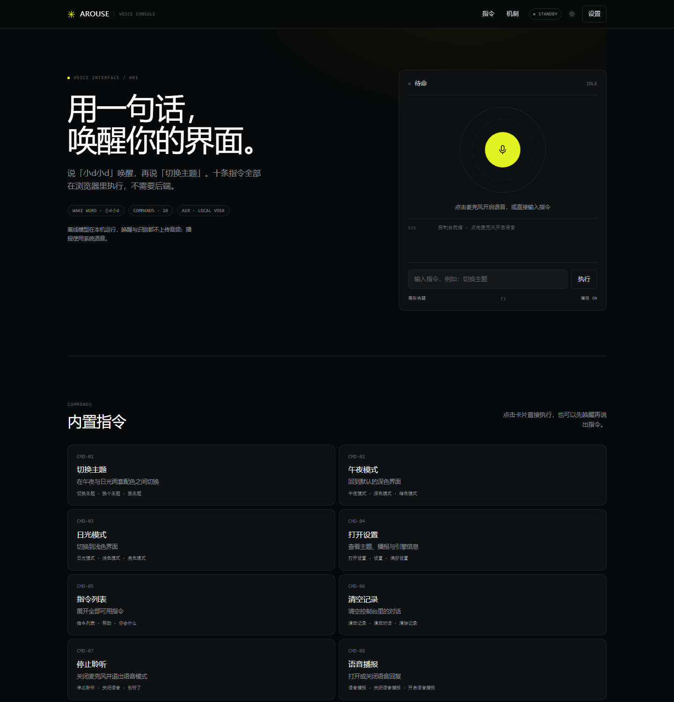
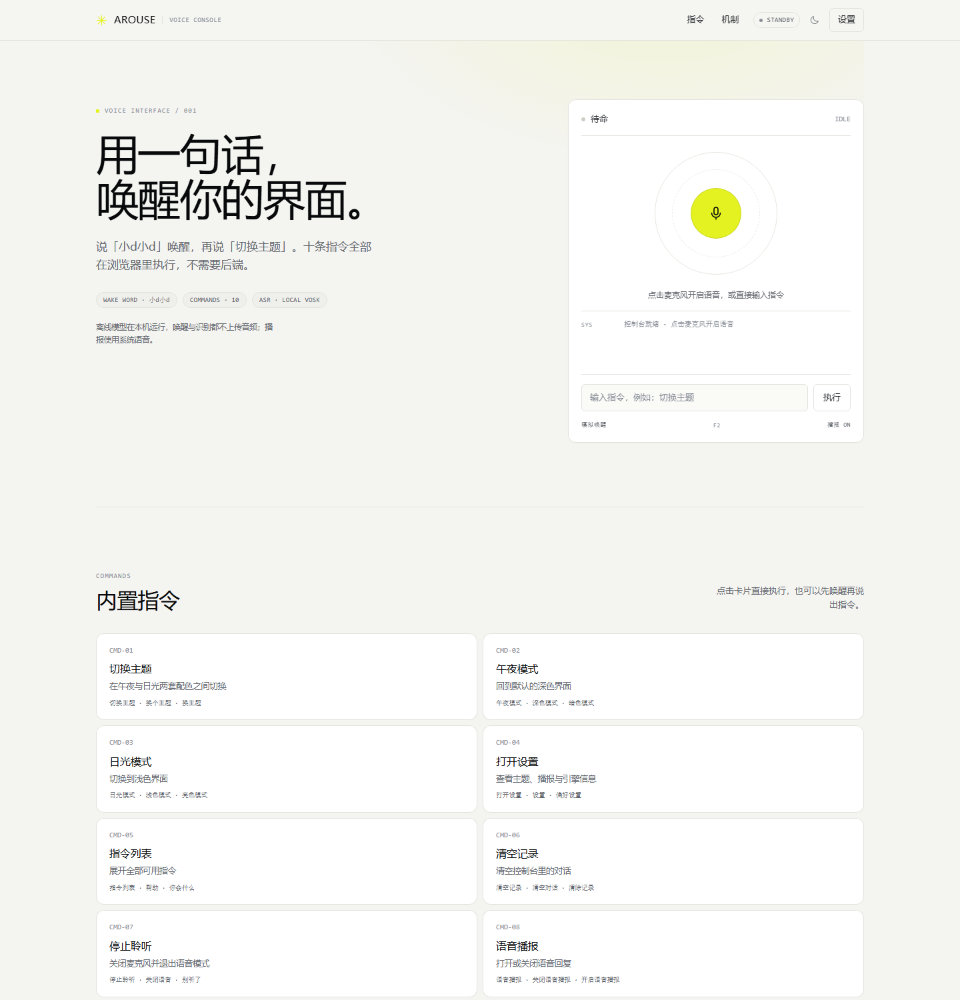

# AROUSE · 语音唤起 Demo 开发文档

> 版本：v0.1.0 ｜ 更新：2026-10-18
> 配套文档：[语音唤起可行性方案.md](语音唤起可行性方案.md) ｜ 设计基线：[DESIGN.md](DESIGN.md)
> 一句话：说「小d小d」唤醒，再说「切换主题」，界面立刻响应。纯 Vue 前端，零后端。





---

## 1. 快速开始

### 1.1 环境

| 项 | 要求 |
| --- | --- |
| Node.js | ≥ 18（本地验证使用 24.15.0） |
| 包管理器 | pnpm ≥ 9（本地验证使用 11.7.0），npm 亦可 |
| 浏览器 | Chrome / Edge 111+（`color-mix` 需要）、Safari 16.4+ |

### 1.2 命令

```bash
pnpm install
pnpm dev          # http://localhost:5173
pnpm build        # vue-tsc --noEmit && vite build
pnpm preview      # 预览构建产物
```

`pnpm-workspace.yaml` 里的 `allowBuilds.esbuild: true` 是 pnpm 10+ 的构建脚本白名单，缺少它 `esbuild` 的二进制不会被安装，`vite build` 会失败。用 npm 安装不受影响。

### 1.3 浏览器行为

| 浏览器 | 唤醒 / 指令 | 说明 |
| --- | --- | --- |
| Edge / Chrome 111+ | ✅ 本地 | Vosk WASM，16k 音频，完全离线 |
| Safari 16.4+ | ◐ 需实测 | 依赖 `AudioContext({ sampleRate: 16000 })` 是否生效 |
| Firefox | ◐ 需实测 | 同上；`ScriptProcessorNode` 仍可用 |
| 任意浏览器（模型加载失败） | 回退 | 先试 Web Speech，再退键盘模式 |

> 主路径不再依赖浏览器内置识别，Edge 与 Chrome 行为一致。Edge 155 暴露 `SpeechRecognition` 只影响**回退路径**；caniuse 的「Edge 不支持」已滞后，但工程上仍按能力检测 + 失败回退，不按 UA 判断。

**键盘模式**不是降级成「不能演示」：点击麦克风后状态进入 `armed`，按 `F2`（或点「模拟唤醒」）即可走完「唤醒 → 输入指令 → 播报」的完整流程。页面会明确提示当前模式。

主题可以通过 URL 参数直接指定，方便截图与联调：

```
http://localhost:5173/?theme=light
```

---

## 2. 设计系统落地（DESIGN.md）

### 2.1 Token 映射

| DESIGN.md | 实现变量 | 值 | 用途 |
| --- | --- | --- | --- |
| Void | `--bg` | `#08090a` | 页面画布 |
| Carbon | `--surface` | `#0f1011` | 控制台卡片、指令卡片 |
| Obsidian | `--surface-2` | `#161718` | 输入框、悬浮层 |
| Graphite | `--border` / `--surface-3` | `#23252a` | 发丝边框、分段控件 |
| Smoke | `--border-strong` | `#383b3f` | 悬停边框、高对比分隔 |
| Fog / Ash | `--muted` / `--dim` | `#8a8f98` / `#62666d` | 次要文字、元信息 |
| Mist | `--text-body` | `#d0d6e0` | 正文 |
| Paper | `--text` | `#ffffff` | 标题、强调 |
| Acid Lime | `--accent` | `#e4f222` | 唯一的强调色 |

排版、圆角、间距同样按 DESIGN.md 的尺度取值：

| 角色 | 实现 | 对应 DESIGN |
| --- | --- | --- |
| Hero 标题 | `clamp(44px, 5.6vw, 64px) / 510 / -0.022em` | Display / Hero |
| 区块标题 | `32px / 400 / -0.022em` | Subheading |
| 正文 | `16px / 400 / 1.5` | Body |
| 说明文字 | `13px / 400` | Caption |
| 等宽元信息 | `10–11px` | Berkeley Mono 替代 |
| 卡片圆角 | `12px` | cards |
| 按钮圆角 | `6px` | buttons |
| 胶囊 | `9999px` | pills |
| 区块间距 | `96px` | section gap |
| 元素间距 | `8px` | element gap |
| 内容宽度 | `1200px` | page max-width |

### 2.2 组件映射

| 页面元素 | DESIGN 组件 | 实现要点 |
| --- | --- | --- |
| 顶部导航 | Nav Text Button | 透明底、13px、悬停只变文字色 + 淡背景 |
| 「设置」按钮 | Ghost / Outline Button | 1px 边框、6px 圆角 |
| 状态胶囊 | Pill Button | `9999px`、等宽字体、10px 字号 |
| 麦克风球 | Primary Action (Acid Lime) | 全页唯一的实心柠檬绿元素 |
| 控制台 / 指令卡 | Card | `#0f1011` + 12px 圆角 + 内描边 |
| 指令输入框 | Text Input | 深底、发丝边框、聚焦提亮边框 |
| 设置弹层 | —（DESIGN 未定义） | 沿用卡片材质 + 原生 `dialog` |

### 2.3 与 DESIGN.md 的偏差（有意为之）

1. **不引入 Web Font**。DESIGN 指定 Inter Variable / Berkeley Mono，实现使用 `'Inter Variable', 'Inter', ui-sans-serif, system-ui` 与 `'Berkeley Mono', 'JetBrains Mono', ui-monospace` 的回退栈。原因是避免外链字体在国内网络下的首屏抖动；DESIGN.md 本身也允许 `system-ui` 作为替代。副作用是 `510 / 590` 这类可变字重会被系统字体近似成 `500 / 600`。
2. **0.5px 发丝线改用 1px 内阴影**。`box-shadow: inset 0 0 0 1px` 在 Windows 不同缩放比下比 `0.5px border` 稳定，视觉密度接近。
3. **新增日光主题**。DESIGN.md 只定义暗色；日光主题是按同一套层级关系派生的（画布 `#f4f4f1` → 卡片 `#fff` → 边界 `#e2e2dc`），柠檬绿保持唯一强调色。它是 Demo 的功能演示对象，不是品牌规范。
4. **Hero 背景加了一层极淡的柠檬绿径向渐变**。DESIGN.md 明确允许「hero atmospheric floor」使用渐变，且禁止用在按钮/卡片/文字上。
5. **中文字号微调**。DESIGN 的 `line-height: 1` 针对拉丁字母，中文标题用 `1.06` 避免行间过挤。

---

## 3. 功能清单

### 3.1 内置指令（10 条）

| 编号 | 指令 | 示例说法 | 执行动作 |
| --- | --- | --- | --- |
| CMD-01 | 切换主题 | 切换主题 / 换个主题 / 切换外观 | 午夜 ↔ 日光，写入 localStorage |
| CMD-02 | 午夜模式 | 深色模式 / 夜间模式 / 暗色模式 | 强制暗色 |
| CMD-03 | 日光模式 | 浅色模式 / 亮色模式 / 日间模式 | 强制亮色 |
| CMD-04 | 打开设置 | 打开设置 / 偏好设置 / 配置 | 打开原生 `dialog` |
| CMD-05 | 指令列表 | 指令列表 / 帮助 / 你会什么 | 滚动到指令区 |
| CMD-06 | 清空记录 | 清空记录 / 清屏 / 清空对话 | 清空控制台日志 |
| CMD-07 | 停止聆听 | 停止聆听 / 关闭语音 / 别听了 | 关闭麦克风，回到 `idle` |
| CMD-08 | 语音播报 | 语音播报 / 关闭播报 / 静音 | 打开或关闭 TTS |
| CMD-09 | 回到顶部 | 回到顶部 / 滚动到顶部 | `window.scrollTo` |
| CMD-10 | 你是谁 | 你是谁 / 介绍一下自己 | 自我介绍 |

每条指令的 `aliases` 还包含若干语音识别常见误写，完整列表见 `src/commands.ts`。

### 3.2 唤醒词

主唤醒词是 **「小d小d」**。Vosk 会把 `xiao-di` 识别成「小弟 / 小滴 / 小丁 / 小的」等，所以不用固定别名，而是用字符集匹配「小 X 小 Y」：

```ts
const WAKE_PATTERN = /小[弟滴迪低底地第丁d的]小[弟滴迪低底地第丁d的]/
```

另外接受「你好小d」「嗨小d」等前缀；判定只看文本**结尾 16 个字符**，避免连续说话时整句过长导致漏检。实测：

| 实际说的话 | Vosk 输出 | 是否命中 |
| --- | --- | --- |
| 小d小d | 小弟 小弟 | ✅ |
| 小滴小滴 | 小丁 小的 | ✅ |
| 今天天气不错 | 今天 天气 不错 | ❌ |

用户一口气说「小d小d 切换主题」时，`extractWakeRemainder()` 会把唤醒词后面的内容取出来直接执行，不用再说第二遍。

### 3.3 快捷键

| 快捷键 | 行为 |
| --- | --- |
| `F2` | 模拟唤醒（跳过麦克风） |
| `Ctrl / ⌘ + K` | 聚焦指令输入框 |
| `Enter` | 执行输入框内容 |
| `Esc` | 关闭设置弹层 |

> 早期版本用的是 `Ctrl + Shift + W`，它在 Chromium 里会直接关闭窗口，因此改成单键 `F2`。`F2` 在 Chrome / Edge 中没有默认绑定，也不会和其他站点快捷键冲突；如果笔记本把 F 键映射成了媒体键，按住 `Fn` 再按 `F2`，或者直接点控制台里的「模拟唤醒」。

---

## 4. 架构

### 4.1 目录结构

```
arouse_demo/
├─ index.html
├─ vite.config.ts
├─ docs/
│  ├─ preview-dark.png
│  └─ preview-light.png
├─ public/
│  └─ models/
│     ├─ model.tar.gz            # Vosk 中文模型，约 42MB（不入 git）
│     └─ README.md               # 模型获取与打包说明
├─ scripts/
│  └─ smoke.html                 # 指令/唤醒词冒烟测试页（仅 dev 用）
└─ src/
   ├─ main.ts
   ├─ App.vue                    # 页面骨架 + 全局快捷键
   ├─ style.css                  # tokens、布局、组件样式、动效
   ├─ types.ts                   # VoiceState / CommandEffect / LogEntry
   ├─ store.ts                   # 主题、播报、面板、日志、Toast
   ├─ commands.ts                # 指令注册表 + 匹配算法
   ├─ lib/
   │  └─ text.ts                 # 归一化、编辑距离、相似度
   ├─ voice/
   │  ├─ vosk.ts                 # 离线识别会话（主路径）
   │  ├─ speech.ts               # 浏览器识别 / TTS / 提示音（回退）
   │  └─ wake.ts                 # 唤醒词检测 + Web Speech 监听（回退）
   ├─ composables/
   │  └─ useAssistant.ts         # 状态机、引擎选择、会话令牌
   └─ components/
      ├─ TopBar.vue
      ├─ VoiceConsole.vue
      ├─ CommandGrid.vue
      └─ SettingsDialog.vue
```

### 4.2 数据流

```
麦克风
  ↓ getUserMedia → AudioContext(16k) → ScriptProcessor(4096)
Vosk KaldiRecognizer（WASM，本机推理）
  ↓ partialresult / result 文本
detectWake()  ← 命中 → 提示音 → 重置识别器，进入 command 阶段
  ↓ 未命中，继续监听
下一句 final 文本（8 秒超时）
  ↓
matchCommand() → command.run() → speak()
  ↓
backToWake() 重置识别器，继续监听
```

整条链路**不需要网络**：模型、推理、指令解析都在本机；TTS 用系统语音。只有「模型加载失败」时才会回退到浏览器内置识别（Web Speech），再失败则进入键盘模式。

音频管线用的是 `ScriptProcessorNode`（4096 帧 / 256ms）。它已被标记废弃，但兼容性最好、实现最简单；要更低延迟或更少主线程占用，可以换成 `AudioWorklet`，把 PCM 帧 `postMessage` 出来再喂 `acceptWaveformFloat()`。

### 4.3 状态机

```
idle ──点击麦克风──▶ arming ──权限 & 引擎就绪──▶ armed
armed ──命中唤醒词──▶ triggered ──提示音──▶ listening
listening ──拿到文本──▶ thinking ──播报──▶ speaking ──结束──▶ armed
listening ──超时/空──▶ armed
triggered ──键盘模式──▶ （等待输入）──提交──▶ thinking
armed ──关闭 / CMD-07──▶ idle
arming ──失败──▶ error
```

| 状态 | UI 表现 | 麦克风 |
| --- | --- | --- |
| `idle` | 灰色状态点，柠檬绿麦克风球 | 关闭 |
| `arming` | 环形 spinner，球体变灰 | 请求中 |
| `armed` | 状态点呼吸，外环脉冲，声波柱缓慢起伏 | 开启 |
| `triggered` | 球体脉冲加快 | 开启（等待提示音结束） |
| `listening` | 环形脉冲 + 球体脉冲，声波柱快速起伏 | 开启 |
| `thinking` | 球体转灰，环形 spinner | 开启 |
| `speaking` | 声波柱 + 播报图标 | 开启但暂停喂引擎 |
| `error` | 红色描边 + 警示图标 | 关闭 |

### 4.4 模块职责

| 模块 | 负责 | 不负责 |
| --- | --- | --- |
| `store.ts` | 主题/播报持久化、日志、Toast、面板开关 | 语音流程 |
| `commands.ts` | 指令定义、别名、执行副作用、文本匹配 | 识别、播报 |
| `voice/vosk.ts` | 模型加载、麦克风、离线识别、wake/command 阶段切换 | 指令执行 |
| `voice/speech.ts` | 浏览器识别回退、TTS、提示音 | 状态机 |
| `voice/wake.ts` | 唤醒词规则、Web Speech 持续监听（回退） | 指令执行 |
| `useAssistant.ts` | 状态迁移、引擎选择、超时、竞态 | DOM 细节 |
| 组件 | 渲染与用户输入 | 业务判断 |

---

## 5. 关键实现

### 5.1 离线识别会话（Vosk）

`src/voice/vosk.ts` 的 `VoskSession` 负责模型、麦克风与识别器的生命周期：

```ts
async start(callbacks: VoskCallbacks) {
  if (!this.model) {
    const Vosk = await import('vosk-browser')
    this.model = await Vosk.createModel(`${import.meta.env.BASE_URL}models/model.tar.gz`)
  }
  await this.openMicrophone()
  this.phase = 'wake'
  this.createRecognizer()
}
```

关键约束：

- `vosk-browser` 是 5.8MB 的 UMD bundle，用动态 `import()` 拆成独立 chunk，首屏只加载约 100KB 主包。
- 模型是 42MB 的 tar.gz，`createModel` 在 Worker 里下载并解压到 Emscripten 内存文件系统；解压会剥掉 tar 的顶层目录，所以直接打包 `vosk-model-small-cn-0.22/`。
- `AudioContext({ sampleRate: 16000 })` 必须生效。若 `context.sampleRate !== 16000`，直接抛错走回退，**不要**把 48k 音频喂给 16k 模型。
- `ScriptProcessorNode(4096)` 必须经 0 增益 `GainNode` 接到 `destination` 才会被驱动。
- 模型加载一次后常驻；`stop()` 只关麦克风，`dispose()` 才 `model.terminate()`。

### 5.2 唤醒 / 命令阶段切换

Vosk 是「一句话一个 final」的流式接口，用 `phase` 区分两种模式：

| phase | `partialresult` | `result` |
| --- | --- | --- |
| `wake` | 命中唤醒词即触发 | 命中唤醒词即触发 |
| `command` | 忽略 | 作为指令交给 `execute()` |

触发唤醒后必须**重建识别器**：否则「小弟 小弟」这句话的 final 会在稍后到达，被当成指令执行。重建用 `setTimeout(..., 0)` 推迟，不能在识别器自己的回调里同步 `remove()`。

命令阶段 8 秒超时；超时回到 `wake` 并提示「没有听清」。用户一口气说「小d小d 切换主题」时，`extractWakeRemainder()` 会取出后半句直接执行。

> `listenOnce()` + `WakeListener` 是回退路径：只有 Vosk 模型加载失败、或拿不到 16k AudioContext 时才启用，代码保留在 `src/voice/speech.ts` 与 `src/voice/wake.ts`。

### 5.3 指令匹配

匹配前先归一化：去掉所有非字母数字字符（`\p{L}\p{N}`），中文、英文、数字保留。

```ts
const NON_WORD = /[^\p{L}\p{N}]/gu
export const normalize = (input: string) => input.toLowerCase().replace(NON_WORD, '')
```

打分规则（`src/commands.ts`）：

| 情况 | 分数 |
| --- | --- |
| 完全相等 | `1.0` |
| 输入包含别名 | `0.8 + 0.18 × (别名长度 / 输入长度)` |
| 别名包含输入（且输入不太短） | `0.7` |
| 其他 | `相似度 × 0.9`（Levenshtein） |

取最高分，且 **≥ 0.66** 才执行；同分时优先更长的别名。这条规则专门解决歧义：

> 「关闭语音播报」同时包含「关闭语音」（CMD-07）与「关闭语音播报」（CMD-08）。
> 更长的别名得分更高，最终命中 CMD-08；只说「关闭语音」才会命中 CMD-07。

冒烟测试里这两条都是 `1.00` 命中且互不干扰。

### 5.4 竞态：会话令牌

语音流程全是异步的：等权限、等识别、等播报。用户中途点「关闭」时，未完成的 Promise 回来会重新开麦——这是语音 Demo 最常见的 bug。

`useAssistant.ts` 用一个自增 `session` 解决：

```ts
let session = 0

async function arm() {
  session += 1
  const id = session
  await warmUpTts()
  if (id !== session) return       // 期间被关闭了
  ensureWake().start()
}

function disarm() {
  session += 1                     // 让所有在途流程失效
  wake?.stop()
  // ...
}
```

`handleWake`、`respond` 在每次 `await` 之后都对比令牌，不一致直接丢弃结果。

### 5.5 播报与提示音

- 提示音用 Web Audio 合成 880Hz 短音，不额外请求音频文件；
- `unlockAudio()` 在「点击开启」这个用户手势里创建/恢复 `AudioContext`，避免后续被自动播放策略挂起；
- TTS 用 `SpeechSynthesisUtterance`，优先选 `zh-*` 音色，并设置了一个按文本长度估算的超时兜底（部分浏览器 `onend` 不触发）；
- 页面卸载、关闭语音、切换命令都会 `speechSynthesis.cancel()`。

### 5.6 主题持久化

```ts
watch(theme, (value) => {
  document.documentElement.dataset.theme = value
  localStorage.setItem('arouse.theme', value)
}, { immediate: true })
```

优先级：URL `?theme=` > `localStorage` > 默认 `dark`。把 URL 参数放在最前，是为了截图、演示和自动化测试可以强制指定主题，而不污染用户偏好。

---

## 6. 视觉与交互

### 6.1 状态 → 视觉

| 元素 | 规则 |
| --- | --- |
| 状态点 | 待命灰 → 聆听柠檬绿呼吸 → 识别快闪 → 异常红 |
| 外环 | `armed` 慢脉冲；`listening` 快脉冲；`thinking` 旋转弧 |
| 麦克风球 | 唯一实心柠檬绿；`thinking`/`arming` 转灰；`error` 红描边 |
| 声波柱 | 仅 `armed` / `listening` / `speaking` 显示，5 根 2px 竖条 |
| 日志 | 最多展示最近 5 条；`SYS` 用等宽小字，`YOU` 用高对比白 |

所有动画都做了 `prefers-reduced-motion` 降级。

### 6.2 响应式

| 断点 | 变化 |
| --- | --- |
| `≤ 1024px` | Hero 变单列，控制台取消 sticky，最大宽 560px |
| `≤ 720px` | 导航隐藏链接与副标题，指令改单列，机制表格堆叠 |
| `≥ 1201px` | 内容居中，最大宽 1200px |

### 6.3 无障碍

- 麦克风球、主题按钮、开关都有 `aria-label` / `role="switch"`；
- 日志容器 `aria-live="polite"`，状态变化会被读屏播报；
- 原生 `<dialog>` 自带焦点陷阱与 `Esc` 关闭；
- 全局 `:focus-visible` 使用柠檬绿 2px 描边，键盘可达；
- 文本对比度：正文与背景约 12:1，元信息约 5.9:1，满足 AA。

---

## 7. 测试

### 7.1 冒烟测试

`scripts/smoke.html` 是一个纯前端测试页，`pnpm dev` 后访问：

```
http://localhost:5173/scripts/smoke.html
```

最近一次结果（Edge Headless，2026-10-18）：

| 输入 | 命中 | 分数 |
| --- | --- | --- |
| 切换主题 | `theme.toggle` | 1.00 |
| 切换 主题（Vosk 带空格） | `theme.toggle` | 1.00 |
| 请帮我切换到浅色模式 | `theme.light` | 0.87 |
| 关闭语音播报 | `tts.toggle` | 1.00 |
| 关闭语音 | `voice.stop` | 1.00 |
| 打开设置 | `settings.open` | 1.00 |
| 清空记录 | `logs.clear` | 1.00 |
| 回到顶部 | `page.top` | 1.00 |
| 你是谁 | `about` | 1.00 |
| 今天天气怎么样 | 未命中 | — |
| 切换 | 未命中（太短，不猜） | — |

唤醒词用 Vosk 的真实输出验证：`小d小d` →「小弟 小弟」✅、`小滴小滴` →「小丁 小的」✅、`你好` ❌；`小弟 小弟 切换 主题` 的 remainder 能正确取出「切换主题」。合计 `0 failed`。

### 7.2 手工验收清单

| # | 场景 | 预期 |
| --- | --- | --- |
| 1 | 点击麦克风并允许权限 | 加载约 42MB 模型后 `arming → armed`，日志出现「离线语音已就绪」 |
| 2 | 说「小d小d」 | 提示音、状态 `triggered → listening` |
| 3 | 说「切换主题」 | 主题切换 + TTS 播报 + 回到 `armed` |
| 4 | 说「停止聆听」 | 麦克风关闭，状态 `idle`，不再自动开麦 |
| 5 | 拒绝麦克风权限 | `error` 状态 + 可读提示，不崩溃 |
| 6 | 点击任意指令卡 | 直接执行，不要求先开麦 |
| 7 | `F2` | 模拟唤醒并聚焦输入框 |
| 8 | 设置里切主题 / 关播报 | 立即生效，刷新后保留 |
| 9 | `Esc` | 关闭设置弹窗 |
| 10 | Edge 打开 | 本地 Vosk 识别，不依赖浏览器内置服务 |

类型检查与构建：

```bash
pnpm build
# vue-tsc --noEmit && vite build
# 主包 101.8KB (gzip 40.8KB) / vosk chunk 5.79MB (gzip 2.35MB) / CSS 16.7KB (gzip 4.1KB)
# public/models/model.tar.gz 约 42MB，构建时原样拷贝
```

---

## 8. 已知限制

1. **模型 42MB，首次加载需要几秒**。Vosk 模型走 `public/models/model.tar.gz`，加载后才进入 `armed`；浏览器会缓存，但内存占用约 200–300MB。
2. **识别精度受 small 模型限制**。安静近场可用，远场/噪声下会下降；唤醒词靠同音正则兜底，不是声学唤醒词模型。
3. **仅前台可用**。标签页关闭、系统休眠后无法唤醒；Edge 的睡眠标签页/效率模式可能冻结后台标签。
4. **没有打断（barge-in）**。播报中再喊唤醒词不会打断，需要等播报结束。
5. **命令阶段 8 秒超时**。唤醒后一直不说话会回到 `armed`；识别器重建瞬间的尾音会被丢弃。
6. **Vosk 不支持热词/自定义词表**。换唤醒词只能改 `src/voice/wake.ts` 的正则，不能「训练」一个新词。
7. **TTS 音色依赖系统**。Windows 中文音色在不同版本上差异较大。
8. **日志不持久化**，刷新即清空（这是有意的，避免 Demo 残留对话）。
9. **模型未入 git**。`public/models/*.tar.gz` 被忽略，新环境需按 `public/models/README.md` 生成一次。

---

## 9. 扩展指南

### 9.1 新增一条指令

三步：

1. 在 `src/commands.ts` 的 `commands` 数组里追加一项，写好 `id`、`no`、`title`、`description`、`aliases`、`run()`；
2. 如果要滚动、聚焦、关麦，在 `CommandEffect` 里加类型，并在 `useAssistant.applyEffects()` 里处理；
3. 在 `scripts/smoke.html` 加一条用例，刷新测试页确认命中。

`run()` 里直接改 Vue 状态即可，例如：

```ts
{
  id: 'panel.close',
  no: 'CMD-11',
  title: '关闭面板',
  description: '收起当前打开的弹层',
  aliases: ['关闭面板', '收起设置', '关掉弹层'],
  run: () => {
    panels.settings = false
    return { reply: '面板已收起。' }
  },
}
```

### 9.2 可选：用 Porcupine 替换唤醒引擎

当前唤醒已经由 Vosk 在本地完成。如果更看重唤醒准确率与功耗，可以把**唤醒层**换成 Porcupine（需要 AccessKey，商用需授权），命令识别仍走 Vosk 或云 ASR。改动点只有一处：把 `VoskSession` 的唤醒匹配换成 Porcupine 引擎。

```bash
pnpm add @picovoice/porcupine-web
```

```ts
import { PorcupineWorker } from '@picovoice/porcupine-web'

const worker = await PorcupineWorker.create(
  import.meta.env.VITE_PICOVOICE_ACCESS_KEY,
  [{ label: '小d小d', publicPath: '/voice/xiaodi_wasm.ppn' }],
  (detection) => void handleWake(detection.label),
  { publicPath: '/voice/porcupine_params_zh.pv' },
)
```

资源放到 `public/voice/`：中文参数模型 `porcupine_params_zh.pv`（约 963KB）+ 控制台导出的 Web/WASM 版 `.ppn`。然后用 `getUserMedia + AudioWorklet` 把 16kHz、512 样本/帧的 PCM 喂给 `worker.process()`，替换掉第 5.2 节的 `WakeListener`。完整音频管线代码见可行性方案 6.2 / 6.3 节。

注意两点：

- 生成模型时用汉字「小滴小滴 / 小迪小迪」，不要直接填「小d小d」，否则 TTS 前端可能读成英文 D；
- **唤醒不等于命令识别**。Edge 里接上 Porcupine 后，唤醒阶段可以离线，但「切换主题」这句话仍然需要云 ASR 或离线 ASR 才能转成文本，否则只能唤醒后键盘输入。

### 9.3 接入云端 ASR

把 `listenOnce()` 换成一个 WebSocket 流式客户端即可，其余状态机不用动：

1. 后端签发短期 token（不要把云厂商 AK/SK 放前端）；
2. 唤醒后建连，把 AudioWorklet 的 16kHz PCM 按 40ms 一包发送；
3. 收到 `final` 文本后调用现有的 `execute(text)`；
4. 超时、断网沿用现有的 `respond()` 与 `resumeWake()`。

`src/voice/speech.ts` 的导出签名保持 `Promise<string>`，上层完全无感。

---

## 10. 常见问题

**Q：Edge 里点击麦克风没反应或报错？**
A：先看控制台日志。`SAMPLE_RATE_*`、模型 404 会回退到 Web Speech；`NotAllowedError` 会停在 `error`。确认 `public/models/model.tar.gz` 存在，且 Windows / Edge 都允许麦克风。

**Q：首次点击为什么要等几秒？**
A：正常。42MB 模型需要下载、解压、初始化，本地约 1–3 秒；加载完成后模型常驻，关麦不会重新加载。

**Q：Chrome 提示「识别服务连不上」？**
A：只有 Vosk 不可用、回退到 Web Speech 时才会出现。Vosk 正常工作时完全不需要网络。

**Q：麦克风指示灯一直亮？**
A：点击麦克风球关闭，或刷新页面。`dispose()` 会停止所有音轨；如果你改过代码，检查是否在 `onBeforeUnmount` 之外创建了新的识别实例。

**Q：为什么不用 AudioWorklet？**
A：当前用 `ScriptProcessorNode` 是为了少一个 worklet 文件，4096 帧约 256ms。要更低延迟可以改成 AudioWorklet，把 PCM 帧交给 `acceptWaveformFloat()`。

**Q：主题切换后刷新又回去了？**
A：主题存在 `localStorage`，隐私模式或禁用存储时会回到默认暗色；URL 的 `?theme=` 优先级最高。

**Q：怎么改唤醒词？**
A：改 `src/voice/wake.ts` 的 `WAKE_PATTERN` 字符集与 `WAKE_GREETINGS`。保留叠词形式，不要加裸「小d」，否则误唤醒会明显上升。

---

## 附录 A · 文件清单

| 文件 | 作用 |
| --- | --- |
| `src/App.vue` | 页面骨架、全局快捷键、Toast |
| `src/style.css` | 设计 token、布局、组件、动效、响应式 |
| `src/store.ts` | 主题/播报/日志/Toast 的响应式状态 |
| `src/commands.ts` | 10 条指令 + 匹配算法 |
| `src/lib/text.ts` | 归一化与编辑距离 |
| `src/voice/speech.ts` | 识别、TTS、提示音 |
| `src/voice/wake.ts` | 唤醒词检测与持续监听 |
| `src/composables/useAssistant.ts` | 状态机与编排 |
| `src/components/*.vue` | 导航、控制台、指令网格、设置弹层 |
| `scripts/smoke.html` | 指令匹配冒烟测试 |

## 附录 B · 参考

- DESIGN.md（Linear 风格基线）
- [语音唤起可行性方案.md](语音唤起可行性方案.md)：选型、状态机、AudioWorklet、Porcupine/sherpa 接入、Edge 专项评估
- caniuse：Speech Recognition 支持情况 — https://caniuse.com/speech-recognition
- MDN：SpeechRecognition — https://developer.mozilla.org/zh-CN/docs/Web/API/SpeechRecognition
- Picovoice：Porcupine Web 快速开始 — https://picovoice.ai/docs/quick-start/porcupine-web/
