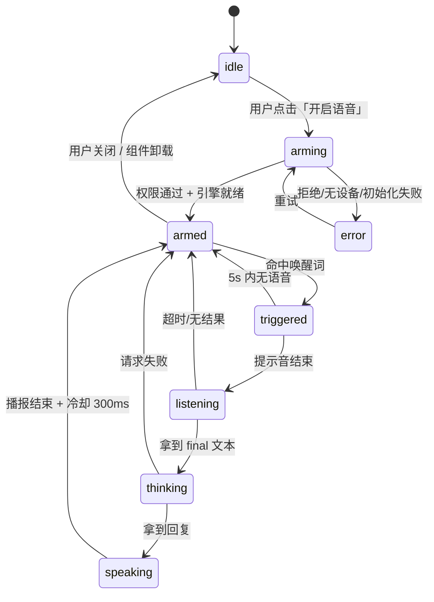

# Vue 3 语音唤起（Wake Word）可行性方案

> 项目：`arouse_demo` ｜ 版本：v1.0 ｜ 更新：2026-10-18
> 目标：在 Vue 前端项目中实现「说唤醒词 → 唤起语音助手 → 语音下达命令 → 语音播报」的完整链路，并给出可落地、可降级、可验收的工程方案。

---

## 目录

- [0. 一页结论](#0-一页结论)
- [1. 先澄清需求](#1-先澄清需求6-个决定架构的问题)
- [2. Web 端能力边界](#2-web-端能力边界必须先认清的硬约束)
- [3. 技术路线对比与选型](#3-技术路线对比与选型)
- [4. 推荐架构](#4-推荐架构)
- [5. 状态机设计](#5-状态机设计整个方案的核心)
- [6. 关键实现](#6-关键实现)
- [7. 性能、功耗与体验指标](#7-性能功耗与体验指标)
- [8. 兼容性与降级策略](#8-兼容性与降级策略)
- [9. 安全、隐私与合规](#9-安全隐私与合规)
- [10. 实施计划](#10-实施计划)
- [11. 成本估算](#11-成本估算)
- [12. 风险清单](#12-风险清单)
- [13. 验收标准（DoD）](#13-验收标准dod)
- [14. 附录](#14-附录)
- [15. 补充评估：Windows + Edge + 中文唤醒词「小d小d」](#15-补充评估windows--edge--中文唤醒词小d小d)

---

## 0. 一页结论

| 维度 | 结论 |
| --- | --- |
| 纯 Web 能否做到「喊一声就唤醒」 | **前台可以，后台/锁屏不行**。页面可见且已授权时，端侧唤醒延迟可做到 300ms 内 |
| 推荐技术栈 | Vue 3 + Vite + TypeScript + Pinia；**端侧 KWS（Porcupine Web，备选 sherpa-onnx WASM）** + 命令 ASR + TTS |
| 唤醒阶段是否上传音频 | **不需要**。端侧引擎本地推理，隐私友好、可离线 |
| 首版工期 | POC 3 人日；MVP 6 人日；加固 + 灰度 7 人日，合计约 17 人日（1 名前端） |
| 最大风险 | 浏览器后台限制、iOS 兼容性、商用授权、国内云端 ASR 可用性 |
| 兜底策略 | 按住说话（PTT）+ 点击唤醒按钮，保证任何浏览器都能用 |

**一句话结论**：
如果把「唤起」定义为*「页面打开并授权后，用户说唤醒词即可进入对话」*，Web 方案完全可行，且端侧唤醒可以做到离线、低功耗、隐私友好；
如果定义为*「App 关闭、锁屏或切到其他应用后仍能被唤醒」*，纯 Web **不可行**，必须使用原生壳（Electron / Capacitor / Flutter）或接入系统级语音助手。这是本方案最关键的边界，需要在立项时对齐。

---

## 1. 先澄清需求（6 个决定架构的问题）

| # | 问题 | 对方案的影响 | 本文默认假设 |
| --- | --- | --- | --- |
| 1 | 唤醒后要做什么？打开面板 / 执行命令 / 进入多轮对话 | 决定是否需要命令 ASR 与 LLM 接入 | 打开语音面板并支持单轮/多轮对话 |
| 2 | 页面不可见（切后台、锁屏）时也必须唤醒吗？ | **是** → 纯 Web 出局，需原生壳 | 否，仅前台 |
| 3 | 目标终端？桌面 Chrome / 移动端 / 微信内置 / 企业内嵌 iframe | 决定兼容矩阵与降级策略 | 桌面 Chrome/Edge 优先，移动端可用，微信内降级 PTT |
| 4 | 唤醒词固定还是可自定义？中文还是英文？ | 决定选 Porcupine（控制台可视化定制）还是 sherpa-onnx（免费、需自己转 token） | 固定中文唤醒词，后续可配置 |
| 5 | 是否允许音频上云？ | 决定命令识别走 Web Speech / 云 ASR / 端侧 ASR | 唤醒音频不上云；命令音频可上云 |
| 6 | 是否商用？有无预算？ | Porcupine 商用需授权；sherpa-onnx 为 Apache-2.0 | 先按可商用但零成本方案设计 |

> 建议：把这张表作为需求评审的 Checklist，答案不同，第 3 节的选型结论会变。

---

## 2. Web 端能力边界（必须先认清的硬约束）

### 2.1 六条硬约束

1. **没有系统级常驻能力**
   浏览器标签页不是后台服务。标签页关闭 = 能力消失；移动端切后台/锁屏，音频采集会被系统挂起。所谓「常驻唤醒」在 Web 里只等于「页面保持打开且可见」。

2. **必须是安全上下文**
   `getUserMedia` / `AudioWorklet` 只在 `https://` 或 `http://localhost` 下可用。局域网真机联调必须给开发服务器配 HTTPS，`http://192.168.x.x` 拿不到麦克风。

3. **首次必须由用户手势触发**
   自动播放策略会挂起 `AudioContext`；麦克风权限也必须来自明确的用户操作。**不要在页面加载时自动申请麦克风**，否则既拿不到权限，也会吓跑用户。

4. **浏览器内置 ASR 兼容性很差**
   按 caniuse（2026-09 数据），`SpeechRecognition` 只有 Chrome 系与 Safari 部分支持，**Edge 旧版本未启用、Firefox 默认关闭**。2026-10 复核时发现 Edge 155 的运行时已经暴露该 API，详见 2.2 的补充说明。

5. **后台标签页会被节流**
   `requestAnimationFrame` 停止、定时器降频；AudioWorklet 在麦克风活跃时通常仍运行，但移动端切后台会被挂起。因此「切后台继续监听」不能作为产品承诺。

6. **会自己唤醒自己**
   TTS 播报的内容若包含唤醒词，会被麦克风拾取造成死循环。必须做「播报期间暂停唤醒 + 回声消除 + 冷却时间」。

### 2.2 浏览器能力矩阵

| 平台 / 浏览器 | 麦克风 + AudioWorklet | `SpeechRecognition`（内置 ASR） | WASM 唤醒引擎 | `SpeechSynthesis` |
| --- | --- | --- | --- | --- |
| Chrome 桌面 ≥ 66 | ✅ | ◐ 需联网，走 Google 服务 | ✅ | ✅ |
| Edge（Chromium） | ✅ | ◐ 155+ 已暴露 API，可用性待验证 | ✅ | ✅ |
| Safari macOS ≥ 14.1 | ✅ | ◐ `webkit` 前缀，功能受限 | ✅ | ✅ |
| iOS Safari ≥ 14.5 | ✅ | ◐ 限制多，自动重启易失败 | ✅ | ✅ 需用户手势 |
| Android Chrome | ✅ | ◐ 部分支持，`continuous` 不可靠 | ✅ | ✅ |
| Firefox | ✅ | ❌ 默认关闭 | ✅ | ✅ |
| 微信内置浏览器（X5/XWeb） | ◐ 需 HTTPS + 授权，部分机型异常 | ❌ | ✅ 但低端机性能吃紧 | ◐ |
| Electron（Chromium） | ✅ | ❌ 建议自建 ASR | ✅ | ✅ |

图例：✅ 可用 ｜ ◐ 部分可用/有限制 ｜ ❌ 不可用

> **2026-10 复核**：本机 Edge 155（`Edg/155.0.0.0`）的 `typeof window.webkitSpeechRecognition` 返回 `function`，说明该 API 已在 Edge 中暴露，caniuse 的「不支持」数据滞后。但「构造器存在」不等于「能识别」——权限、Windows 麦克风开关、厂商语音服务任一环失败都会报错。工程上应做能力检测 + 失败降级，不要按 UA 判断。

### 2.3 国内网络的现实问题

Chrome 的 `SpeechRecognition` 依赖 Google 的语音服务，**在中国大陆基本不可用**，典型表现是 `onerror` 收到 `network`。这意味着：

> **不要把 Web Speech API 作为唯一链路**，它只适合做 POC 或海外用户降级方案。

真正可用的组合是：端侧 KWS 做唤醒 → 国内云厂商（阿里云 / 腾讯云 / 讯飞 / 火山引擎）流式 ASR 做命令识别 → 云 TTS 或系统 TTS 播报。

---

## 3. 技术路线对比与选型

### 3.1 五种候选方案

| # | 方案 | 唤醒原理 | 唤醒延迟 | 离线 | 误唤醒 | 成本 | 工程量 | 定位 |
| --- | --- | --- | --- | --- | --- | --- | --- | --- |
| A | Web Speech 常开 + 文本匹配 | 云端持续出字，前端正则匹配唤醒词 | 0.5–1.5s | ❌ | 中（同音词） | 云 ASR 流量 | 低 | 仅 POC |
| B | **Porcupine Web** | WASM 专用 KWS，`.ppn` 模型 | 100–300ms | ✅ | 低 | 商用需授权 | 中 | **推荐（有预算）** |
| C | **sherpa-onnx WASM KWS** | Zipformer-KWS 3.3M 模型 | 200–400ms | ✅ | 低–中 | 0（Apache-2.0） | 中高 | **推荐（零成本/可定制中文）** |
| D | openWakeWord（onnxruntime-web） | ONNX 模型推理 | 200–400ms | ✅ | 中 | 0 | 中 | 备选（英文生态强） |
| E | VAD + 云流式 ASR | 端点检测后上传识别 | 0.8–2s | ❌ | 低 | 云 ASR 费用 | 中 | **命令识别层** |
| F | 原生壳（Electron / Capacitor） | 原生 KWS 或系统热词 | <100ms | ✅ | 低 | 高 | 高 | 需后台常驻时 |

### 3.2 选型结论

```
唤醒层：Porcupine Web（首选，准确率与延迟最好，中文唤醒词可在控制台一键生成）
         └─ 若商用授权成本不可接受 → sherpa-onnx WASM KWS（完全免费、可自训、需自己处理 token）
命令层：VAD 断句 + 云厂商流式 ASR（WebSocket）
         └─ 降级：Web Speech API（仅 Chrome/海外）→ 再降级：手动输入
播报层：SpeechSynthesis（零成本、够用）
         └─ 音色要求高 → 云 TTS
兜底层：按住说话（PTT），覆盖所有不支持的环境
```

**为什么不用「Web Speech 常开 + 文本匹配」做唤醒？**
一是它本质上把麦克风音频持续送到云端，隐私与流量都不可接受；二是国内不可用；三是 `continuous = true` 在 Chrome 上会因静音自动结束，需要不断重启，实际稳定性很差。它适合 1 天内验证产品价值，不适合上线。

**为什么推荐端侧 KWS？**
唤醒词识别是一个「小词表、低功耗、常驻」的任务，和通用 ASR 是两类问题。专用 KWS 模型只有几 MB，CPU 占用约 1%–3%，且**唤醒阶段的音频不出设备**，在合规叙事上非常有利。

---

## 4. 推荐架构

### 4.1 分层结构

```
┌───────────────────────────── Vue 3 应用 ─────────────────────────────┐
│ UI 层     VoiceOrb 状态球 / 波形 / 字幕 / 权限引导 / 设置面板          │
│ ──────────────────────────────────────────────────────────────────── │
│ 状态层    Pinia voiceStore + 有限状态机                                │
│           idle → arming → armed → triggered → listening → speaking    │
│ ──────────────────────────────────────────────────────────────────── │
│ 能力层    WakeEngine 适配器  │  ASR 适配器        │  TTS 适配器        │
│           Porcupine / sherpa │  WebSpeech / 云 WS  │  Synthesis / 云   │
│ ──────────────────────────────────────────────────────────────────── │
│ 音频层    getUserMedia → AudioContext → AudioWorklet                  │
│           16kHz / 单声道 / 512 帧（32ms）→ RMS/VAD → 分发              │
└───────────────────────────────────────────────────────────────────────┘
          │ 仅「命令阶段」音频（可配置是否上传）        │ 业务请求
          ▼                                            ▼
     云端流式 ASR / LLM 服务                        业务后端
```

**关键设计**：音频只采集一次，由 AudioWorklet 分帧后**同时**喂给唤醒引擎和（唤醒后的）命令识别，避免重复占用麦克风、避免两套采集逻辑。这也是把 `PorcupineWorker` 与 `@picovoice/web-voice-processor` 分开使用的原因——后者的便利性会独占麦克风，无法复用音频流。

### 4.2 一次完整交互的时序

```
用户            前端                      端侧引擎            云端
 │  说「小助小助」 │                          │                 │
 │───────────────▶│ AudioWorklet 32ms/帧     │                 │
 │                │─────────────────────────▶│ KWS 推理         │
 │                │◀─────────────────────────│ 命中             │
 │                │ 播放提示音 + UI 动效      │                 │
 │  说「打开设置」  │ 开始收集命令音频          │                 │
 │───────────────▶│─── VAD 断句 ─────────────┼────────────────▶│ 流式 ASR
 │                │◀─────────────────────────┼─────────────────│ final 文本
 │                │──────── 业务/LLM 请求 ────────────────────▶│
 │                │◀──────── 回复文本 ────────────────────────│
 │ 听到播报        │ TTS 播报（期间暂停 KWS）  │                 │
 │                │ 冷却 300ms → 回到 armed  │                 │
```

### 4.3 技术选型清单

| 层 | 选型 | 版本/说明 | 理由 |
| --- | --- | --- | --- |
| 框架 | Vue 3 + `<script setup>` + TypeScript | 3.5+ | 组合式 API 便于封装音频生命周期 |
| 构建 | Vite | 6.x | 原生 ESM、`?url` 处理 Worklet、HTTPS 插件 |
| 状态 | Pinia | 2.x/3.x | 状态机与 UI 解耦 |
| 唤醒 | `@picovoice/porcupine-web` | 4.x | WASM、Worker、中文唤醒词 |
| 唤醒备选 | `sherpa-onnx` WASM KWS | 1.10+ | 零成本、Apache-2.0 |
| 命令 ASR | 云厂商流式 ASR（WebSocket） | 阿里云/腾讯云/讯飞 | 国内可用、首字延迟低 |
| 命令 ASR 降级 | `SpeechRecognition` | 浏览器内置 | 零后端成本，仅作兜底 |
| TTS | `SpeechSynthesis` | 内置 | 零成本、免网络 |
| 测试 | Vitest + Playwright | — | 状态机单测 + 权限流程 E2E |

---

## 5. 状态机设计（整个方案的核心）

语音交互 80% 的 bug 来自状态没管好：重复唤醒、播报被打断、权限失败后卡死、离开页面麦克风不关。**先把状态机定死，再写代码。**

### 5.1 状态定义

| 状态 | 含义 | 麦克风 | 唤醒引擎 |
| --- | --- | --- | --- |
| `idle` | 未开启 / 用户关闭 | 关闭 | 停止 |
| `arming` | 申请权限、加载模型、初始化音频 | 开启中 | 初始化中 |
| `armed` | 待唤醒（核心常驻态） | 开启 | 运行 |
| `triggered` | 已唤醒，播放提示音、等待说话 | 开启 | **暂停**（防自唤醒） |
| `listening` | 命令识别中 | 开启 | 暂停 |
| `thinking` | 请求后端 / LLM | 可关闭 | 暂停 |
| `speaking` | TTS 播报 | 开启 | **暂停** |
| `error` | 权限/设备/网络异常 | 关闭 | 停止 |

### 5.2 状态迁移



### 5.3 迁移规则与定时器

| 规则 | 值 | 说明 |
| --- | --- | --- |
| 唤醒冷却 | 1500ms | 冷却期内忽略重复命中，防止一句话触发多次 |
| 唤醒后等待说话 | 5000ms | 超时回 `armed` 并给出轻提示 |
| 命令识别超时 | 8000ms | 超时视为未识别，回 `armed` |
| 播报后冷却 | 300ms | 等回声消散，避免尾音自唤醒 |
| 错误退避 | 1s → 2s → 4s → 8s（上限 30s） | 自动重启 ASR 时使用，避免死循环打爆接口 |
| 后台自动挂起 | `visibilitychange` 隐藏 60s 后 | 释放麦克风省电；回到前台需用户点击恢复（移动端尤其重要） |

### 5.4 三个容易踩的边界

1. **打断（barge-in）**：播报中用户再次唤醒，应 `speechSynthesis.cancel()` 并切到 `listening`。首版建议**不做**打断，降低复杂度。
2. **权限被永久拒绝**：`NotAllowedError` 后浏览器不再弹窗，只能引导用户去「站点设置 → 麦克风」手动恢复，必须给文案。
3. **组件卸载 / 路由切换 / HMR**：必须 `stop()` 所有轨道并 `close()` AudioContext，否则浏览器标签页的麦克风指示灯会一直亮，用户会以为被监听。

---

## 6. 关键实现

### 6.1 工程结构

```
arouse_demo/
├─ public/
│  └─ voice/
│     ├─ porcupine_params.pv          # 引擎参数（约几百 KB）
│     └─ hey-arouse_wasm.ppn          # 唤醒词模型（控制台导出，务必选 Web/WASM 版本）
├─ src/
│  ├─ voice/
│  │  ├─ audio/
│  │  │  ├─ pcm-worklet.js            # AudioWorklet，必须是纯 JS
│  │  │  └─ capture.ts                # 麦克风采集封装
│  │  ├─ wake/
│  │  │  ├─ engine.ts                 # WakeEngine 接口
│  │  │  ├─ porcupine.ts              # Porcupine 适配
│  │  │  └─ sherpa.ts                 # sherpa-onnx 适配（备选）
│  │  ├─ asr/
│  │  │  ├─ web-speech.ts             # 浏览器内置 ASR（降级）
│  │  │  └─ cloud-stream.ts           # 云端流式 ASR
│  │  ├─ tts/index.ts                 # 播报
│  │  └─ errors.ts                    # 错误码 → 人话
│  ├─ composables/useVoiceWake.ts     # 编排层
│  ├─ stores/voice.ts                 # Pinia
│  └─ components/VoiceOrb.vue         # UI
├─ .env.local                         # VITE_PICOVOICE_ACCESS_KEY
└─ vite.config.ts
```

### 6.2 音频采集：AudioWorklet 分帧 + 重采样

`src/voice/audio/pcm-worklet.js`（**纯 JS，不能写 TS / 不能有 import**）：

```js
/**
 * 把设备原生采样率（常见 48k / 44.1k）重采样为 16kHz 单声道，并按 512 帧（32ms）切块。
 * 输出：Float32Array，通过 port 转移所有权（零拷贝）。
 */
class PcmFramer extends AudioWorkletProcessor {
  constructor(options) {
    super()
    const opts = options.processorOptions || {}
    this.frameSize = opts.frameSize || 512
    this.targetRate = opts.targetSampleRate || 16000
    // 每输入一个样本，输出进度前进多少
    this.step = this.targetRate / sampleRate
    this.phase = 0
    this.acc = 0
    this.count = 0
    this.frame = new Float32Array(this.frameSize)
    this.write = 0
  }

  process(inputs) {
    const channel = inputs[0] && inputs[0][0]
    if (!channel) return true

    for (let i = 0; i < channel.length; i++) {
      this.acc += channel[i]
      this.count += 1
      this.phase += this.step

      if (this.phase >= 1) {
        // 块平均是最廉价的抗混叠手段，对 KWS 足够
        this.frame[this.write++] = this.acc / this.count
        this.phase -= 1
        this.acc = 0
        this.count = 0

        if (this.write === this.frameSize) {
          const out = this.frame
          this.port.postMessage(out, [out.buffer])
          this.frame = new Float32Array(this.frameSize)
          this.write = 0
        }
      }
    }
    return true
  }
}

registerProcessor('pcm-framer', PcmFramer)
```

`src/voice/audio/capture.ts`：

```ts
import workletUrl from './pcm-worklet.js?url'

export interface CaptureOptions {
  frameSize?: number
  targetSampleRate?: number
  onFrame: (frame: Float32Array, rms: number) => void
}

const rms = (frame: Float32Array) => {
  let sum = 0
  for (let i = 0; i < frame.length; i++) sum += frame[i] * frame[i]
  return Math.sqrt(sum / frame.length)
}

export class VoiceCapture {
  private ctx: AudioContext | null = null
  private stream: MediaStream | null = null
  private source: MediaStreamAudioSourceNode | null = null
  private node: AudioWorkletNode | null = null

  get active() {
    return this.ctx !== null
  }

  async start(opts: CaptureOptions) {
    if (this.ctx) return
    if (!navigator.mediaDevices?.getUserMedia) throw new Error('MIC_UNSUPPORTED')

    const stream = await navigator.mediaDevices.getUserMedia({
      audio: {
        channelCount: 1,
        echoCancellation: true, // 必须开：抑制 TTS 自唤醒
        noiseSuppression: true,
        autoGainControl: true,
      },
      video: false,
    })
    this.stream = stream

    const ctx = new AudioContext({ latencyHint: 'interactive' })
    this.ctx = ctx
    if (ctx.state === 'suspended') await ctx.resume() // 必须发生在用户手势内
    await ctx.audioWorklet.addModule(workletUrl)

    const node = new AudioWorkletNode(ctx, 'pcm-framer', {
      numberOfInputs: 1,
      numberOfOutputs: 0,
      channelCount: 1,
      processorOptions: {
        frameSize: opts.frameSize ?? 512,
        targetSampleRate: opts.targetSampleRate ?? 16000,
      },
    })
    this.node = node
    node.port.onmessage = (ev: MessageEvent<Float32Array>) => {
      opts.onFrame(ev.data, rms(ev.data))
    }

    const source = ctx.createMediaStreamSource(stream)
    this.source = source
    source.connect(node)
  }

  /** 彻底释放：轨道不停，标签页的麦克风指示灯会一直亮 */
  async stop() {
    this.node?.port.close()
    this.node?.disconnect()
    this.source?.disconnect()
    this.stream?.getTracks().forEach((track) => track.stop())
    if (this.ctx && this.ctx.state !== 'closed') await this.ctx.close()
    this.ctx = null
    this.stream = null
    this.node = null
    this.source = null
  }
}
```

> 兼容提示：极少数老浏览器不驱动 `numberOfOutputs: 0` 的节点，可改成 1 个输出，经 `GainNode(gain = 0)` 接到 `ctx.destination`。
> 若不用自定义 Worklet，也可以直接用 `@picovoice/web-voice-processor`，但它会独占麦克风，无法把同一路音频复用给命令 ASR。

### 6.3 唤醒引擎适配层

先定义接口，方便在 Porcupine / sherpa-onnx / 未来自研之间切换：

```ts
// src/voice/wake/engine.ts
export interface WakeEngine {
  init(): Promise<void>
  feed(frame: Float32Array): void
  release(): Promise<void>
  onDetected: (keyword: string) => void
}
```

Porcupine 实现（`@picovoice/porcupine-web`）：

```ts
// src/voice/wake/porcupine.ts
import { PorcupineWorker } from '@picovoice/porcupine-web'
import type { WakeEngine } from './engine'

const toPcm16 = (frame: Float32Array) => {
  const pcm = new Int16Array(frame.length)
  for (let i = 0; i < frame.length; i++) {
    const s = Math.max(-1, Math.min(1, frame[i]))
    pcm[i] = s < 0 ? s * 0x8000 : s * 0x7fff
  }
  return pcm
}

export class PorcupineEngine implements WakeEngine {
  onDetected: (keyword: string) => void = () => {}
  private worker: PorcupineWorker | null = null

  constructor(
    private opts: { accessKey: string; label: string; modelPath: string; paramsPath: string },
  ) {}

  async init() {
    if (!this.opts.accessKey) throw new Error('MISSING_ACCESS_KEY')
    this.worker = await PorcupineWorker.create(
      this.opts.accessKey,
      [{ label: this.opts.label, publicPath: this.opts.modelPath }],
      (detection) => this.onDetected(detection.label),
      { publicPath: this.opts.paramsPath }, // porcupine_params.pv
      { processErrorCallback: (e) => console.error('[porcupine]', e) },
    )
  }

  feed(frame: Float32Array) {
    // Porcupine 要求 16kHz、每帧 512 样本
    void this.worker?.process(toPcm16(frame))
  }

  async release() {
    await this.worker?.release()
    this.worker = null
  }
}
```

使用：

```ts
const engine = new PorcupineEngine({
  accessKey: import.meta.env.VITE_PICOVOICE_ACCESS_KEY,
  label: 'hey arouse',
  // 部署到子路径时 BASE_URL 保证路径正确
  modelPath: `${import.meta.env.BASE_URL}voice/hey-arouse_wasm.ppn`,
  paramsPath: `${import.meta.env.BASE_URL}voice/porcupine_params.pv`,
})
```

> 模型文件必须在 Picovoice Console 里按 **Web (WASM)** 平台导出，选错平台会加载失败。
> `AccessKey` 会暴露在前端，属正常设计，但要在控制台限制允许的域名并定期轮换；不要把它当成服务端密钥。
> 上面按 v3/v4 的 `create(accessKey, keywords, onDetection, model, options)` 编写；大版本之间参数顺序可能调整，接入时以官方 README 为准。

sherpa-onnx 备选（零成本、可完全离线）：

```ts
// src/voice/wake/sherpa.ts —— 参数示意，实际以官方 WASM 示例与 C++ API 为准
// 模型（二选一）：
//   sherpa-onnx-kws-zipformer-zh-en-3M-2025-12-20        中英混合，约 3M 参数
//   sherpa-onnx-kws-zipformer-wenetspeech-3.3M-2024-01-01 纯中文
const kws = await createKws({
  encoder: '/models/kws/encoder-epoch-12-avg-2-chunk-16-left-64.onnx',
  decoder: '/models/kws/decoder-epoch-12-avg-2-chunk-16-left-64.onnx',
  joiner: '/models/kws/joiner-epoch-12-avg-2-chunk-16-left-64.onnx',
  tokens: '/models/kws/tokens.txt',
  keywordsFile: '/models/kws/keywords.txt',
  numThreads: 1,
  provider: 'cpu',
})

// 每帧送入后轮询是否命中
kws.acceptWaveform(frame)
while (kws.isDetected()) {
  const { keyword } = kws.getResult()
  engine.onDetected(keyword)
  kws.reset()
}
```

> `keywords.txt` 每行一个关键词，格式为「编码 token + 可选调参」，例如：
> `▁小 ▁爱 同 学 :2.0 #0.6`。其中 `:2.0` 是 boosting score（越大越容易触发），`#0.6` 是触发阈值（越小越容易触发）。
> 用 `sherpa-onnx-cli text2token --tokens tokens.txt --tokens-type cjkchar+bpe` 从原始文本生成；中文也可用 `ppinyin`（部分拼音）以提升鲁棒性。
> 这两个参数就是「误唤醒 vs 漏唤醒」的调优旋钮，比改代码有效得多。
> 注意：sherpa-onnx 的 WASM 绑定主要面向 ASR，KWS 需要自行编译/封装 glue code，这是它相对 Porcupine 多出来的主要工程量。
> 若启用多线程 WASM，必须配置 COOP/COEP 响应头，否则会退回单线程。

### 6.4 命令识别

**降级方案：浏览器内置 ASR**（Chrome / 海外可用，负责「能用」而不是「好用」）

```ts
// src/voice/asr/web-speech.ts
export interface RecognizeOptions {
  timeout?: number
  lang?: string
}

export function createWebSpeechASR(defaults: RecognizeOptions = {}) {
  const Ctor =
    (window as any).SpeechRecognition ?? (window as any).webkitSpeechRecognition
  const supported = Boolean(Ctor)
  let active: any = null

  function recognizeOnce(opts: RecognizeOptions = {}): Promise<string> {
    return new Promise((resolve, reject) => {
      if (!Ctor) return reject(new Error('ASR_UNSUPPORTED'))
      if (active) return reject(new Error('ASR_BUSY'))

      const rec = new Ctor()
      active = rec
      let settled = false

      const finish = (text: string) => {
        if (settled) return
        settled = true
        window.clearTimeout(timer)
        try { rec.stop() } catch { /* 已结束 */ }
        active = null
        resolve(text)
      }
      const fail = (code: string) => {
        if (settled) return
        settled = true
        window.clearTimeout(timer)
        active = null
        reject(new Error(code))
      }

      const timer = window.setTimeout(() => finish(''), opts.timeout ?? 8000)
      rec.lang = opts.lang ?? defaults.lang ?? 'zh-CN'
      rec.continuous = false
      rec.interimResults = false
      rec.maxAlternatives = 1
      rec.onresult = (e: any) => {
        const result = e.results[e.results.length - 1]
        finish(String(result?.[0]?.transcript ?? '').trim())
      }
      rec.onerror = (e: any) => (e.error === 'no-speech' ? finish('') : fail(e.error))
      rec.onend = () => finish('')

      try {
        rec.start()
      } catch (err) {
        fail('ASR_START_FAILED')
      }
    })
  }

  return { supported, recognizeOnce, abort: () => active?.abort() }
}
```

**主方案：云端流式 ASR**（16kHz / 16bit / 单声道 PCM，WebSocket 推流）

```ts
// src/voice/asr/cloud-stream.ts
const toPcm16Buffer = (frame: Float32Array) => {
  const pcm = new Int16Array(frame.length)
  for (let i = 0; i < frame.length; i++) {
    const s = Math.max(-1, Math.min(1, frame[i]))
    pcm[i] = s < 0 ? s * 0x8000 : s * 0x7fff
  }
  return pcm.buffer
}

export class CloudASR {
  private ws: WebSocket | null = null

  constructor(
    private opts: {
      url: string
      token: string
      onPartial?: (text: string) => void
      onFinal: (text: string) => void
      onError?: (err: Error) => void
    },
  ) {}

  async connect() {
    const ws = new WebSocket(`${this.opts.url}?token=${encodeURIComponent(this.opts.token)}`)
    ws.binaryType = 'arraybuffer'
    await new Promise<void>((resolve, reject) => {
      ws.onopen = () => resolve()
      ws.onerror = () => reject(new Error('ASR_CONNECT_FAILED'))
    })
    ws.onmessage = (ev) => {
      const msg = JSON.parse(String(ev.data))
      if (msg.type === 'partial') this.opts.onPartial?.(msg.text)
      if (msg.type === 'final') this.opts.onFinal(msg.text)
      if (msg.type === 'error') this.opts.onError?.(new Error(msg.code))
    }
    this.ws = ws
  }

  send(frame: Float32Array) {
    if (this.ws?.readyState !== WebSocket.OPEN) return
    this.ws.send(toPcm16Buffer(frame))
  }

  close() {
    this.ws?.close()
    this.ws = null
  }
}
```

实施要点：

- 每帧 32ms，攒 40ms 或直接透传，按厂商要求封装帧头；
- **鉴权 token 必须由后端签发**（短期、限流），前端绝不放 AccessKey/Secret；
- 需要同时发送「开始 / 结束」控制帧，否则无法及时拿到 final；
- 只有 `listening` 状态才 `send()`，其余状态一律不推流，省流量也符合隐私预期。

### 6.5 播报（TTS）与自唤醒抑制

```ts
// src/voice/tts/index.ts
const ensureVoices = async (timeout = 1500) => {
  const synth = window.speechSynthesis
  if (synth.getVoices().length) return
  await new Promise<void>((resolve) => {
    const done = () => {
      synth.onvoiceschanged = null
      resolve()
    }
    synth.onvoiceschanged = done
    window.setTimeout(done, timeout)
  })
}

const splitText = (text: string, size: number) => {
  const out: string[] = []
  for (let i = 0; i < text.length; i += size) out.push(text.slice(i, i + size))
  return out
}

const speakChunk = (text: string, lang: string) =>
  new Promise<void>((resolve, reject) => {
    const utter = new SpeechSynthesisUtterance(text)
    utter.lang = lang
    utter.rate = 1
    utter.onend = () => resolve()
    utter.onerror = (e) =>
      e.error === 'interrupted' || e.error === 'canceled' ? resolve() : reject(e)
    window.speechSynthesis.speak(utter)
  })

/** Chrome 对超长文本会在 ~15s 处截断，必须分段 */
export async function speak(text: string, lang = 'zh-CN') {
  const synth = window.speechSynthesis
  if (!synth) throw new Error('TTS_UNSUPPORTED')
  await ensureVoices()
  synth.cancel()
  for (const chunk of splitText(text, 120)) {
    await speakChunk(chunk, lang)
  }
}

export const stopSpeaking = () => window.speechSynthesis?.cancel()
```

自唤醒抑制的三道保险：

1. `echoCancellation: true`（浏览器 AEC）；
2. 播报期间状态为 `speaking`，`onFrame` 里直接不喂唤醒引擎；
3. 播报结束后再等 300ms 才恢复，避开尾音与混响。

### 6.6 编排层

```ts
// src/composables/useVoiceWake.ts
import { computed, onScopeDispose, shallowRef } from 'vue'
import { VoiceCapture } from '@/voice/audio/capture'
import { PorcupineEngine } from '@/voice/wake/porcupine'
import { createWebSpeechASR } from '@/voice/asr/web-speech'
import { speak, stopSpeaking } from '@/voice/tts'
import { humanizeError } from '@/voice/errors'
import { useVoiceStore } from '@/stores/voice'

const WAKE_COOLDOWN = 1500
const SPEAK_COOLDOWN = 300
const HIDDEN_DISARM_DELAY = 60_000

export function useVoiceWake() {
  const store = useVoiceStore()
  const capture = shallowRef<VoiceCapture | null>(null)
  const engine = shallowRef<PorcupineEngine | null>(null)
  const asr = createWebSpeechASR()

  let armed = false
  let busy = false
  let lastWakeAt = 0
  let hideTimer: number | undefined

  const state = computed(() => store.state)

  async function arm() {
    if (armed) return
    store.setState('arming')
    try {
      const eng = new PorcupineEngine({
        accessKey: import.meta.env.VITE_PICOVOICE_ACCESS_KEY,
        label: 'hey arouse',
        modelPath: `${import.meta.env.BASE_URL}voice/hey-arouse_wasm.ppn`,
        paramsPath: `${import.meta.env.BASE_URL}voice/porcupine_params.pv`,
      })
      // 先挂载，后续任一步失败时 teardown 都能释放 Worker
      engine.value = eng
      // 多唤醒词场景可在这里接收 keyword 并分流
      eng.onDetected = () => void onWake()
      await eng.init()

      const cap = new VoiceCapture()
      await cap.start({
        // 只在「待唤醒」状态喂引擎：triggered/listening/speaking 自动静默
        onFrame: (frame) => {
          if (store.state === 'armed') eng.feed(frame)
        },
      })

      capture.value = cap
      armed = true
      store.setState('armed')
      document.addEventListener('visibilitychange', onVisibilityChange)
    } catch (err) {
      store.setError(humanizeError(err))
      store.setState('error')
      await teardown()
    }
  }

  async function onWake() {
    const now = performance.now()
    if (!armed || busy || store.state !== 'armed') return
    if (now - lastWakeAt < WAKE_COOLDOWN) return
    lastWakeAt = now
    busy = true

    store.setState('triggered')
    playCue()

    try {
      store.setState('listening')
      const text = await asr.recognizeOnce({ timeout: 8000 })
      if (!text) {
        store.setState('armed')
        return
      }

      store.transcript = text
      store.setState('thinking')
      const reply = await store.ask(text)

      store.setState('speaking')
      await speak(reply)
      await sleep(SPEAK_COOLDOWN)
    } catch (err) {
      store.setError(humanizeError(err))
    } finally {
      busy = false
      if (armed) store.setState('armed')
    }
  }

  async function disarm() {
    if (!armed && !capture.value) return
    armed = false
    document.removeEventListener('visibilitychange', onVisibilityChange)
    window.clearTimeout(hideTimer)
    await teardown()
    store.setState('idle')
  }

  async function teardown() {
    asr.abort()
    stopSpeaking()
    await capture.value?.stop()
    await engine.value?.release()
    capture.value = null
    engine.value = null
  }

  function onVisibilityChange() {
    if (document.visibilityState === 'hidden') {
      // 移动端切后台会被系统挂起，这里主动省电并避免「假在线」
      hideTimer = window.setTimeout(() => void disarm(), HIDDEN_DISARM_DELAY)
    } else {
      window.clearTimeout(hideTimer)
    }
  }

  onScopeDispose(() => void disarm())

  return { state, arm, disarm, supported: asr.supported }
}

const sleep = (ms: number) => new Promise((resolve) => setTimeout(resolve, ms))

function playCue() {
  // 提示音在 iOS 上可能被自动播放策略拦截；可用已解锁的 AudioContext 复用播放
  const ctx = new AudioContext()
  const osc = ctx.createOscillator()
  const gain = ctx.createGain()
  osc.frequency.value = 880
  gain.gain.setValueAtTime(0.0001, ctx.currentTime)
  gain.gain.exponentialRampToValueAtTime(0.15, ctx.currentTime + 0.01)
  gain.gain.exponentialRampToValueAtTime(0.0001, ctx.currentTime + 0.12)
  osc.connect(gain).connect(ctx.destination)
  osc.start()
  osc.stop(ctx.currentTime + 0.14)
  osc.onended = () => void ctx.close()
}
```

### 6.7 Pinia Store

```ts
// src/stores/voice.ts
import { defineStore } from 'pinia'

export type VoiceState =
  | 'idle' | 'arming' | 'armed' | 'triggered'
  | 'listening' | 'thinking' | 'speaking' | 'error'

export const useVoiceStore = defineStore('voice', {
  state: () => ({
    state: 'idle' as VoiceState,
    error: '',
    transcript: '',
    reply: '',
  }),
  actions: {
    setState(next: VoiceState) {
      this.state = next
      if (next !== 'error') this.error = ''
    },
    setError(message: string) {
      this.error = message
    },
    async ask(text: string): Promise<string> {
      // 演示用：接真实后端时删掉这段
      if (import.meta.env.VITE_MOCK === '1') {
        return `你说的是「${text}」，这是模拟回复。`
      }
      const res = await fetch(`${import.meta.env.VITE_API_BASE}/assistant`, {
        method: 'POST',
        headers: { 'Content-Type': 'application/json' },
        body: JSON.stringify({ text }),
      })
      if (!res.ok) throw new Error(`HTTP_${res.status}`)
      const data = (await res.json()) as { reply: string }
      this.reply = data.reply
      return data.reply
    },
  },
})
```

### 6.8 组件与交互

```vue
<!-- src/components/VoiceOrb.vue -->
<script setup lang="ts">
import { computed } from 'vue'
import { useVoiceWake } from '@/composables/useVoiceWake'

const { state, arm, disarm } = useVoiceWake()
const LABELS: Record<string, string> = {
  idle: '点击开启语音',
  arming: '正在初始化…',
  armed: '说「小助小助」唤醒',
  triggered: '我在听…',
  listening: '请说指令',
  thinking: '思考中…',
  speaking: '正在播报',
  error: '点击重试',
}
const label = computed(() => LABELS[state.value] ?? '')
const toggle = () => (state.value === 'idle' || state.value === 'error' ? arm() : disarm())
</script>

<template>
  <button class="orb" :data-state="state" @click="toggle">
    <span class="pulse" />
    <span class="label">{{ label }}</span>
  </button>
</template>

<style scoped>
.orb[data-state='armed'] .pulse { animation: breathe 2.4s ease-in-out infinite; }
.orb[data-state='listening'] .pulse { animation: breathe 0.8s ease-in-out infinite; }
@keyframes breathe { 50% { transform: scale(1.15); opacity: 0.6; } }
</style>
```

UX 细节（容易被忽略但直接影响可用性）：

- 首屏**只放一个按钮**，点击后才申请权限；在此之前不要 `getUserMedia`；
- 权限被拒后展示「如何恢复」的具体路径，而不是一句「请允许麦克风」；
- `armed` 状态必须有可见提示（呼吸灯/文案），用户才知道麦克风开着；
- 提供一键关闭，关闭后麦克风指示灯必须熄灭；
- 移动端按钮加 `touch-action: manipulation`，避免双击缩放。

### 6.9 配置

```ts
// vite.config.ts
import { defineConfig } from 'vite'
import vue from '@vitejs/plugin-vue'
import basicSsl from '@vitejs/plugin-basic-ssl' // 真机联调必须 HTTPS
import { fileURLToPath, URL } from 'node:url'

export default defineConfig({
  plugins: [vue(), basicSsl()],
  resolve: {
    alias: { '@': fileURLToPath(new URL('./src', import.meta.url)) },
  },
  server: { host: true, port: 5173 },
  // 只有使用多线程 WASM 时才需要，且会影响第三方资源加载
  // headers: {
  //   'Cross-Origin-Opener-Policy': 'same-origin',
  //   'Cross-Origin-Embedder-Policy': 'require-corp',
  // },
})
```

```bash
# .env.local
VITE_PICOVOICE_ACCESS_KEY=你的AccessKey
VITE_API_BASE=http://localhost:3000/api
VITE_MOCK=1
```

```ts
// src/vite-env.d.ts（追加，获得环境变量类型提示）
interface ImportMetaEnv {
  readonly VITE_PICOVOICE_ACCESS_KEY: string
  readonly VITE_API_BASE: string
  readonly VITE_MOCK: string
}
```

### 6.10 错误文案映射

浏览器抛出的都是 `DOMException`，直接展示给用户等于没有提示。统一在这里翻译：

```ts
// src/voice/errors.ts
export function humanizeError(err: unknown): string {
  const name = (err as DOMException)?.name ?? ''
  switch (name) {
    case 'NotAllowedError':
    case 'PermissionDeniedError':
    case 'SecurityError':
      return '麦克风权限被拒绝。请点击地址栏左侧的锁形图标 → 网站设置 → 麦克风，改为「允许」后刷新重试。'
    case 'NotFoundError':
    case 'DevicesNotFoundError':
      return '没有检测到麦克风设备，请确认设备已连接。'
    case 'NotReadableError':
    case 'TrackStartError':
      return '麦克风被其他程序占用，请关闭会议或录音软件后重试。'
    case 'AbortError':
      return '语音采集中断，请重试。'
    default:
      if ((err as Error)?.message === 'MISSING_ACCESS_KEY') {
        return '缺少 Picovoice AccessKey，请检查 .env.local 配置。'
      }
      return (err as Error)?.message || '语音功能初始化失败，请重试。'
  }
}
```

---

## 7. 性能、功耗与体验指标

| 指标 | 目标值 | 测量方法 |
| --- | --- | --- |
| 唤醒延迟（说出唤醒词 → 命中） | P95 ≤ 300ms | `performance.mark` 埋点 |
| 唤醒 → UI 反馈 | P95 ≤ 400ms | 同上 |
| 命令首字延迟（云流式） | P95 ≤ 800ms | WebSocket 首包时间 |
| 空闲 CPU（armed 状态） | ≤ 5% 单核 | DevTools Performance 录制 5 分钟 |
| 内存增量 | ≤ 100MB | DevTools Memory |
| 首屏包体积增量 | ≤ 3MB（gzip 后） | `vite build` 报告 |
| 连续运行 | 2 小时无泄漏、无中断 | 长跑脚本 + 定时唤醒 |
| 唤醒率（安静 1m） | ≥ 95% | 每词 20 次人工测试 |

优化手段：

1. **懒加载**：进入语音页再 `import()` 唤醒引擎，模型文件走 CDN + `Cache-Control: immutable`；
2. **Worker 化**：PorcupineWorker 本身在 Worker 内推理，不阻塞主线程；sherpa-onnx 也放 Worker；
3. **状态节流**：非 `armed` 状态不喂帧、不上传，CPU 与流量都能降一个量级；
4. **动画降级**：`speaking` 时降低波形刷新频率，避免主线程抖动影响 TTS；
5. **真机测电**：移动端连续 arm 30 分钟，记录耗电百分比（建议 ≤ 5%/30min）。

---

## 8. 兼容性与降级策略

| 场景 | 典型表现 | 降级策略 |
| --- | --- | --- |
| 浏览器不支持 AudioWorklet | 老版 Safari/WebView | 用 `ScriptProcessorNode` 兜底，或直接 PTT |
| 无麦克风 / 无权限 | `NotFoundError` / `NotAllowedError` | 明确文案 + PTT + 键盘输入 |
| 设备被占用 | `NotReadableError` | 提示关闭会议/录音软件，提供重试 |
| 微信内置浏览器 | 权限弹窗不出现或采集失败 | 默认收起语音，仅保留 PTT |
| iOS 切后台 / 锁屏 | 采集挂起、识别中断 | 回前台提示「语音已暂停，点击恢复」 |
| 不支持内置 ASR | Firefox / Edge | 唤醒后弹输入框（半语音）或走云 ASR |
| 云端 ASR 不可用 | 连接失败 / 超时 | 自动切 Web Speech → 再切手动输入 |
| 公司内网 / 老版本 Chrome | WASM 加载失败 | 提示升级浏览器，保持 PTT 可用 |

**PTT（按住说话）是必须实现的第一优先级兜底**：实现成本低（`pointerdown` 开始采集、`pointerup` 结束并识别），却能覆盖 100% 的浏览器环境。建议在 POC 阶段就做掉。

---

## 9. 安全、隐私与合规

| 项 | 要求 |
| --- | --- |
| 告知与同意 | 首次开启弹层说明：为什么用麦克风、音频是否上传、保存多久；获得明示同意后再申请权限 |
| 最小化采集 | 唤醒阶段音频**只在内存中**，不落盘、不上传 |
| 命令音频 | 默认仅流式传输，不持久化；如业务需要留存，单独告知并设置期限 |
| 传输安全 | 全链路 TLS 1.2+；ASR token 由后端签发、短期有效 |
| 凭据管理 | 前端只放 Picovoice AccessKey（域名白名单 + 轮换）；云厂商 AK/SK 严禁下发 |
| 权限声明 | 响应头 `Permissions-Policy: microphone=(self)`；iframe 需 `allow="microphone; autoplay"` |
| 用户控制 | 一键关闭语音、清除对话记录；关闭后立即 `track.stop()` |
| 第三方清单 | Porcupine（本地推理，不上传）、云 ASR（上传命令音频）、TTS（本地）需在隐私政策中列明 |

合规提示：声纹属于敏感个人信息，若产品涉及「声纹识别/声纹登录」，需要**单独同意**并做影响评估；本方案只做唤醒词匹配与语音转文字，不建立声纹模板，风险等级低得多，但仍需履行告知义务。

---

## 10. 实施计划

### 10.1 里程碑

| 阶段 | 内容 | 交付物 | 工期 |
| --- | --- | --- | --- |
| P0 方案确认 | 需求澄清、浏览器能力验证、选型评审 | 本文档 | 1 人日 |
| P1 POC | Web Speech 唤醒链路跑通 + Porcupine 端侧唤醒跑通 + PTT | 可演示 Demo | 3 人日 |
| P2 MVP | 状态机、权限流程、唤醒引擎、命令 ASR、TTS、错误处理 | 可用版本 | 6 人日 |
| P3 加固 | 兼容性矩阵、真机测试、性能与内存、隐私合规 | 测试报告 | 4 人日 |
| P4 灰度 | 埋点（唤醒率/误唤醒/延迟）、阈值调优、文档 | 上线版本 | 3 人日 |
| 合计 |  |  | **约 17 人日** |

### 10.2 任务拆解（P2 阶段）

1. `VoiceCapture` + Worklet + 重采样（0.5d）
2. Porcupine 接入 + 模型资源 + 错误码（1d）
3. 状态机 + Pinia store + 定时器（1d）
4. 命令 ASR：云流式 + Web Speech 降级（1.5d）
5. TTS + 自唤醒抑制 + 打断策略（首版仅支持「取消播报」，不做语音打断）（0.5d）
6. UI：状态球、权限引导、错误提示、设置项（1d）
7. 生命周期：路由切换 / KeepAlive / HMR / 卸载清理（0.5d）

### 10.3 测试方案

| 测试项 | 方法 | 通过标准 |
| --- | --- | --- |
| 唤醒率（近场） | 安静环境 1m，每个唤醒词 20 次 | ≥ 95% |
| 唤醒率（远场） | 3m 距离，正常音量 | ≥ 85% |
| 抗噪 | 60dB 白噪/人声底噪 | ≥ 80% |
| 误唤醒 | 连续播放中文播客 8 小时 | ≤ 2 次 |
| 唤醒延迟 | 埋点统计 100 次 | P95 ≤ 300ms |
| 自唤醒 | 播报含唤醒词的回复 20 次 | 0 次触发 |
| 权限异常 | 拒绝 / 撤销 / 设备占用 | 文案准确、可重试 |
| 生命周期 | 路由切换、组件卸载、HMR | 麦克风指示灯熄灭 |
| 长稳 | 连续 arm 2 小时 | 无崩溃、内存增长 ≤ 20% |

---

## 11. 成本估算

| 项 | 单价（示意，以官网为准） | 说明 |
| --- | --- | --- |
| Porcupine | 个人/非商用免费；商用需授权 | 按产品/设备询价，需提前确认预算 |
| sherpa-onnx | 0 | Apache-2.0，可商用、可离线 |
| 云流式 ASR | 约 1–3 元/小时 | 阿里云/腾讯云/讯飞/火山，阶梯计价 |
| 云 TTS | 约 1–2 元/万字符 | 视音色与并发 |
| 带宽 | 16kHz × 16bit ≈ 32KB/s | 仅命令阶段上传，唤醒阶段为 0 |

示例：1000 DAU，人均每天语音交互 10 分钟 → 约 5000 小时/月 → ASR 成本约 0.5–1.5 万元/月。若把命令识别也换成本地 ASR（sherpa-onnx），可进一步降到接近 0，代价是包体积与低端机性能。

---

## 12. 风险清单

| 风险 | 概率 | 影响 | 应对 |
| --- | --- | --- | --- |
| 后台/锁屏无法唤醒，产品预期不符 | 高 | 高 | 立项时明确边界；确需常驻则评估 Electron/Capacitor |
| iOS 兼容性差（自动重启、权限） | 高 | 中 | 真机矩阵 + PTT 兜底 + 明确提示 |
| 国内 Web Speech 不可用 | 高 | 高 | 不把它当主链路，端侧 KWS + 国内云 ASR |
| 误唤醒扰民 | 中 | 中 | 阈值调优 + 冷却 + 可关闭 + 误唤醒埋点 |
| Porcupine 商用授权成本 | 中 | 中 | 提前询价；sherpa-onnx 作为可切换备选 |
| 模型体积拖慢首屏 | 中 | 低 | 懒加载 + CDN + 预加载提示 |
| 回声导致死循环 | 中 | 中 | AEC + 播报期间暂停 + 冷却 |
| 隐私合规 | 中 | 高 | 明示同意、本地唤醒、不落盘、可关闭 |
| 低端安卓机性能不足 | 中 | 低 | 检测设备性能，降级为 PTT |

---

## 13. 验收标准（DoD）

1. Chrome / Edge（Chromium）最新版、Safari 17+、iOS 16+ 可正常开启并连续运行 30 分钟不崩溃；
2. 安静环境 1m 唤醒率 ≥ 95%，3m ≥ 85%；
3. 连续播放中文内容 8 小时，误唤醒 ≤ 2 次；
4. 唤醒到 UI 反馈 P95 ≤ 400ms；
5. 空闲 CPU ≤ 5%，内存增量 ≤ 100MB；
6. 权限拒绝、无设备、设备占用、网络异常均有可读提示与重试入口；
7. 关闭语音、路由切换、组件卸载后麦克风轨道停止（系统指示灯熄灭）；
8. 唤醒阶段不产生任何音频上传（可通过 Network 面板审计）；
9. 不支持的环境自动降级到 PTT，不出现白屏或卡死。

---

## 14. 附录

### 14.1 快速验证（30 分钟出 Demo）

```bash
# 在空目录中执行（当前目录即项目根）
pnpm create vite . --template vue-ts
pnpm add pinia @picovoice/porcupine-web
pnpm add -D @vitejs/plugin-basic-ssl
```

先用浏览器内置 ASR 验证「唤醒 → 识别 → 播报」的产品链路是否成立（Chrome + 科学网络环境）：

```ts
const rec = new (window as any).webkitSpeechRecognition()
rec.lang = 'zh-CN'
rec.continuous = true
rec.interimResults = true
rec.onresult = (e: any) => {
  const text = Array.from(e.results).map((r: any) => r[0].transcript).join('')
  if (text.includes('小助小助')) console.log('wake!')
}
rec.onend = () => setTimeout(() => rec.start(), 300) // 必须延迟，否则抛 InvalidStateError
rec.start()
```

链路验证通过后，再按第 6 节替换为端侧唤醒 + 云 ASR。

### 14.2 常见坑清单

1. **在 `onend` 里同步调 `start()`** → `InvalidStateError`，必须延迟 100–300ms 并做退避；
2. **页面加载就申请麦克风** → 无手势被拦截，且用户体验极差；
3. **AudioContext 未 `resume()`** → 采集到全 0 数据；
4. **忘记 `track.stop()`** → 麦克风指示灯常亮，被用户当成偷听；
5. **Vite HMR 重复创建实例** → 多个 AudioContext 叠加，内存暴涨，可用 `import.meta.hot.dispose` 清理；
6. **`KeepAlive` 缓存页面** → `onDeactivated` 里也要停止采集；
7. **Worklet 文件写了 TS 语法** → 浏览器直接报语法错误，必须是纯 JS；
8. **`?url` 路径用了相对路径** → 部署到子路径后 404，统一用 `import.meta.env.BASE_URL`；
9. **Chrome TTS 长文本被截断** → 按 120 字分段播报；
10. **播报时唤醒引擎仍在跑** → 自己把自己唤醒，进入死循环；
11. **`getVoices()` 首次为空** → 监听 `voiceschanged`；
12. **在 iframe 里用麦克风** → 需要 `allow="microphone"`，且父页面权限策略允许。

### 14.3 参考链接

- caniuse：Speech Recognition API 支持情况 — https://caniuse.com/speech-recognition
- MDN：SpeechRecognition — https://developer.mozilla.org/zh-CN/docs/Web/API/SpeechRecognition
- MDN：AudioWorkletNode — https://developer.mozilla.org/zh-CN/docs/Web/API/AudioWorkletNode
- Picovoice：Porcupine Web 快速开始 — https://picovoice.ai/docs/quick-start/porcupine-web/
- Picovoice：定价与授权 — https://picovoice.ai/pricing/
- sherpa-onnx：关键词识别（KWS）文档 — https://k2-fsa.github.io/sherpa/onnx/kws/index.html
- openWakeWord（开源唤醒词，备选） — https://github.com/dscripka/openWakeWord
- Chrome 自动播放策略 — https://developer.chrome.com/blog/autoplay

### 14.4 术语

| 术语 | 含义 |
| --- | --- |
| KWS | Keyword Spotting，关键词/唤醒词检出，只判断「有没有说某个词」 |
| ASR | Automatic Speech Recognition，把语音转成文本 |
| VAD | Voice Activity Detection，判断「有没有人在说话」，用于断句 |
| PTT | Push To Talk，按住说话 |
| AEC | Acoustic Echo Cancellation，回声消除，防止扬声器的声音被麦克风拾取 |
| 误唤醒 | False Accept，没喊唤醒词却触发了 |
| 漏唤醒 | False Reject，喊了却没触发 |

---

> **最终建议**：先花 3 天做 POC（PTT + 端侧唤醒 + 一次完整对话），验证「用户是否愿意对着网页说话」这个产品假设；技术可行性不是瓶颈，**使用场景与预期管理**才是。确认要长期做之后，再投入 P2 的工程化改造。

---

## 15. 补充评估：Windows + Edge + 中文唤醒词「小d小d」

> 追加于 2026-10-18。针对「纯前端 WASM 离线唤醒」这条路线，按目标环境（Windows / Edge）和具体唤醒词做专项复核。

### 15.1 结论

| 方案 | 在 Edge + 中文「小d小d」下的可行性 | 主要代价 | 建议 |
| --- | --- | --- | --- |
| **Porcupine（中文模型）** | **高** | 商用授权 | **首选**，0.5–1 天可跑通 |
| **sherpa-onnx KWS** | 中高 | 需自行封装 WASM，3–5 天 | 零成本/可商用备选 |
| Mellon（EfficientWord-Net） | 低–中 | 0.0.x 项目，中文效果未知 | 只做技术预研，不上生产 |
| Vosk / web-voice-kit | 中 | 42MB 模型 + 持续 ASR 的 CPU | **不建议做唤醒层** |

一句话：**这条路线本身可行，Edge 也是合适的浏览器；真正决定成败的是选哪个引擎，以及「小d」怎么发音建模。**

### 15.2 原文里需要修正的四点

1. **「模型通常几十 MB」只适用于 Vosk 这类全量 ASR。**
   专用 KWS 模型很小：Porcupine 中文参数 `porcupine_params_zh.pv` 约 963KB，唤醒词 `.ppn` 通常几百 KB，合计 1–2MB；sherpa-onnx 的 3.3M 参数 KWS 即使 fp32 也只有十几 MB。首屏策略和「几十 MB 预加载」完全不是一回事。

2. **COOP/COEP 不是所有方案的前置条件。**
   它只在需要 `SharedArrayBuffer`（onnxruntime-web 多线程、`numThreads > 1`）时才必须。Porcupine 不需要；sherpa 单线程也不需要，只是慢一点。
   而一旦开启 `Cross-Origin-Embedder-Policy: require-corp`，页面里**所有**第三方资源（图片、字体、CDN、iframe、埋点）都必须带 CORP/CORS 头，否则直接加载失败。先按单线程做，确实不够快再开。

3. **Mellon 是「能用」，但还不是「可依赖」。**
   npm 上的 `mellon` 目前是 **0.0.x**（2026-03 首发，最新 0.0.26），MIT，底层是 EfficientWord-Net（ResNet-50 + ArcFace 的 few-shot 方案），注册一个词需要 ≥3 段 1.5s 录音。
   两个现实问题：① 官方没有中文语料与中文指标，跨语言效果必须自己测；② 「录 3 遍」若让每个用户做，体验不可接受——正确做法是产品侧录一次、把 `_ref.json` 随包发布（它宣称 speaker-independent，但中文是否成立仍要验证）。
   结论：适合验证「few-shot 能不能识别小d」，**不适合直接写进生产承诺**。

4. **web-voice-kit 的「唤醒」其实是「连续 ASR + 文本匹配」。**
   它的 `WakeWordDetectorStandalone` 用 Vosk 跑持续识别，再用 `pinyin-pro` 做拼音匹配；模型 `vosk-model-small-cn-0.22` 约 42MB，CPU 是持续 ASR 的量级；后续转写走讯飞 WebSocket（需要 appId/apiKey）。
   所以它既不是轻量 KWS，也不是端到端离线。**Vosk 适合放在「唤醒后的离线指令识别」位置，不要放在唤醒层。**

### 15.3 「小d小d」的发音陷阱（最容易翻车的地方）

- 「小d」里的 D 在中文语境通常读 **dī**（同「滴」），但真实用户也可能读 **dì**（同「弟」），或直接念两个字母。
- **生成模型时要用汉字**，不要直接填「小d小d」：TTS / 文本前端可能读成英文 “D”，或直接跳过，训练出来的模型和用户实际读音对不上。
- 推荐写法：主词用「**小滴小滴**」或「**小迪小迪**」，展示名仍叫「小d小d」。
- 同时注册 2–3 个近似变体（Porcupine 的 `keywords` 数组可挂多个 `.ppn`；sherpa 的 `keywords.txt` 可写多行），召回会明显提升。
- 引导文案里统一读法（例如「请说：小滴 小滴」），否则用户第一次大概率读错。

### 15.4 Edge / Windows 专属检查清单

| # | 检查项 | 说明 |
| --- | --- | --- |
| 1 | Windows 设置 → 隐私和安全性 → 麦克风 → 允许桌面应用访问麦克风 | Edge 属桌面应用，这一层关掉时 `getUserMedia` 直接失败 |
| 2 | Edge 站点权限 → 麦克风 → 允许 | 「关闭浏览器时清除 Cookie」会把权限一起清掉，下次需重新授权 |
| 3 | Edge 睡眠标签页 / 效率模式 | 后台标签可能被冻结，唤醒随之中断；在 设置 → 系统和性能 里把站点加入「永不休眠」，或明确「仅前台标签可用」 |
| 4 | 不要指望 `SpeechRecognition` | Edge 155+ 虽已暴露 API，但可用性受权限/服务影响；命令识别仍应准备云 ASR 或离线 ASR |
| 5 | AudioContext 需手势 `resume()` | 否则采集到全 0 数据 |
| 6 | 嵌入 WebView2 时 | 麦克风权限由宿主控制（`CoreWebView2PermissionRequested`），网页侧不会弹系统框 |
| 7 | HTTPS | `localhost` 例外；局域网 IP 必须配证书 |
| 8 | 多标签抢麦克风 | 后开的标签会失败或抢占，UI 要能提示 |

### 15.5 30 分钟可行性验证（先测再立项）

1. Picovoice Console 新建唤醒词 → 语言选中文（普通话）→ 输入「小滴小滴」→ 平台选 **Web (WASM)** → 下载 `.ppn`；同时下载 `porcupine_params_zh.pv`。
2. 用本文 6.3 的代码起一个 Vite 页面，注意 `paramsPath` 指向 **zh** 模型。
3. 记录四个数：
   - 近场 1m，读 50 次，命中几次；
   - 3m 远场，读 30 次；
   - 播放 1 小时中文播客，误唤醒几次；
   - 任务管理器里 Edge 的 CPU 占用。
4. 通过线：近场 ≥ 95%、远场 ≥ 85%、1 小时误唤醒 ≤ 1、空闲 CPU ≤ 3%。
5. 如果控制台没有中文选项（账号/区域差异），**直接转 sherpa-onnx**，不要用英文近似音硬凑——那是「看起来能跑，实际不可用」。

### 15.6 按约束选型

| 你的约束 | 选它 | 备注 |
| --- | --- | --- |
| 最快上线，可接受授权费 | Porcupine 中文 | 1–2MB，无需 COOP/COEP，Edge 直接跑 |
| 必须零成本、可商用 | sherpa-onnx KWS | Apache-2.0，需自己编译 WASM + 生成 keywords |
| 只是内部验证 few-shot | Mellon | 0.0.x，锁版本，别对外承诺 |
| 还要**离线识别指令**（不只是唤醒） | 唤醒用 Porcupine/sherpa，指令叠 Vosk/sherpa ASR | 预算 42MB+ 模型与 CPU |
| 要实现锁屏/后台唤醒 | —— | 纯 Web 无解，转 Electron/Capacitor 或系统助手 |

> 再强调一次：**离线唤醒 ≠ 离线对话**。唤醒词可以 1MB 本地搞定；一旦要识别「打开设置」「今天天气」，就是另一套 40MB+ 的 ASR 工程，两者要分开评估。

